Create monthly payroll, enter variable payments and deductions, and check the figures before preparing payslips.

:::info Sample payroll
The sample company runs SQL Payroll version 2.2026.325.249. The payroll period is October 2026, and all amounts are in Singapore dollars. Enter your own payroll period, employee details, and approved transactions.
:::

## 1 Before You Start

Check the following before creating payroll:

- Complete the [Company Profile](./sg-user-guide.md#21-setting-up-company-profile).
- In [Maintain Employee](./sg-user-guide.md#31-maintain-employee), check each employee's wages, contribution type, payment method, join date, and resignation date.
- Check the employee's citizenship and, where applicable, Permanent Resident information. Confirm the employee's [Self-Help Group](./sg-user-guide.md#316-self-help-group).
- Set up the required [wages](./sg-user-guide.md#41-maintain-wages), [contribution](./sg-user-guide.md#42-maintain-contribution), [allowance](./sg-user-guide.md#43-maintain-allowance), [deduction](./sg-user-guide.md#44-maintain-deduction), and [overtime](./sg-user-guide.md#45-maintain-overtime) codes. Check their contribution options before using them.
- Check **Payroll | Open Payroll** to see whether the period has already been processed. If it has, open that payroll to make changes.

The sample entries are for employee **001** (AARON TAN):

| Item               | Example                                                           |
| ------------------ | ----------------------------------------------------------------- |
| Wages              | Monthly wages of $4,800.00.                                       |
| Fixed allowance    | M01: Meal, $300.00, from the employee's setup.                    |
| Variable allowance | H01: Handphone, 1 work unit at $150.00.                           |
| Overtime           | HWD: Working Day (Hourly x1.5), 2 hours on 30 October 2026.       |
| Deduction          | R01: Equipment Repayment, 1 work unit at $50.00.                  |

In the sample payroll, wages, allowances, and overtime count as CPF Ordinary Wages. The equipment repayment reduces take-home pay and leaves the CPF wage base unchanged. These codes are for the sample company. Choose codes set up for your own transactions.

CPF contributions are [payable on overtime](https://www.cpf.gov.sg/service/article/are-cpf-contributions-payable-on-overtime-pay). For employees entitled to a full month's salary, [calculate CPF on their salary before deducting money they owe the employer](https://www.cpf.gov.sg/service/article/are-cpf-contributions-payable-on-salary-deductions), as explained by CPF Board.

## 2 Create Monthly Payroll

1. Navigate to **Payroll | New Payroll**.

    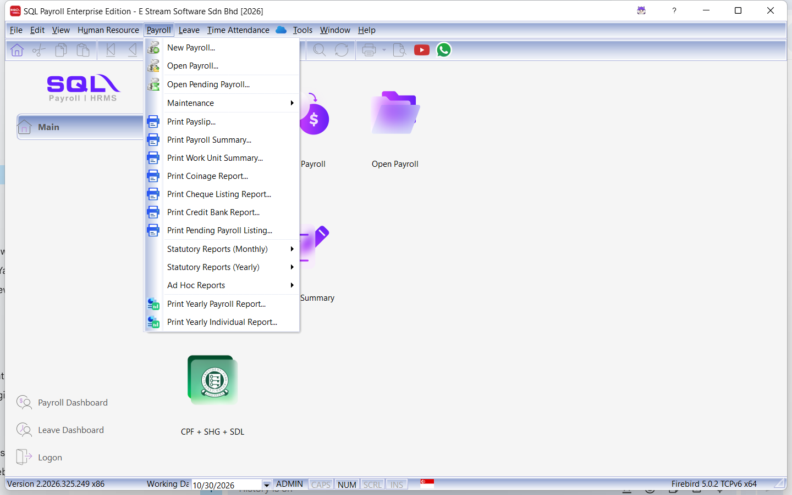

2. Select **Final**, enter the payroll period and dates, and check the employees to include.

    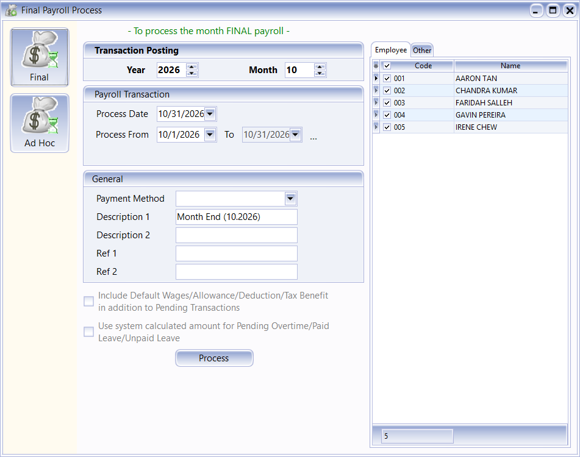

    | Field Name                    | Definition                                                       |
    | ----------------------------- | ---------------------------------------------------------------- |
    | Year                          | Year to which the payroll is posted.                             |
    | Month                         | Month to which the payroll is posted.                            |
    | Process Date                  | Date of the payroll process. The example uses 31 October 2026.   |
    | Process From / To             | Start and end dates of the payroll period.                       |
    | Payment Method                | Payment method selected for the payroll process, if applicable.  |
    | Description 1                 | Description of the payroll process, such as Month End (10.2026). |
    | Description 2                 | Additional description for the payroll process.                  |
    | Ref 1 / Ref 2                 | Reference information for the payroll process.                   |
    | Employee                      | Check the employees to include in this payroll process.          |

3. Click **Process**. The employee list and **Welcome** tab open for the new payroll.

    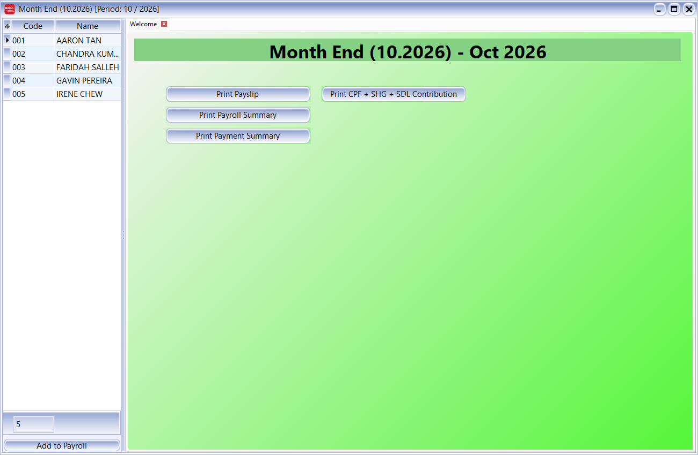

:::info Previous payroll period
If SQL Payroll warns that the previous month's Final payroll has not been processed, check your payroll history before deciding whether to continue. The sample company has no September 2026 payroll.
:::

## 3 Open Saved Payroll

Use **Open Payroll** to review or change saved payroll.

1. Navigate to **Payroll | Open Payroll**.

    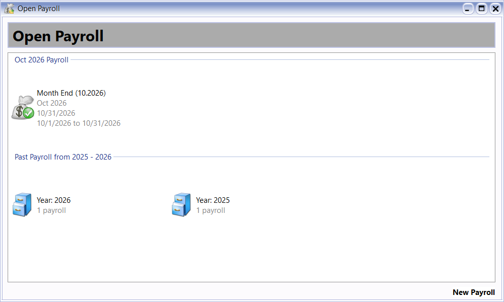

2. Double-click the payroll shown for the current month. To open another period, double-click its year, then double-click the payroll process you need.

    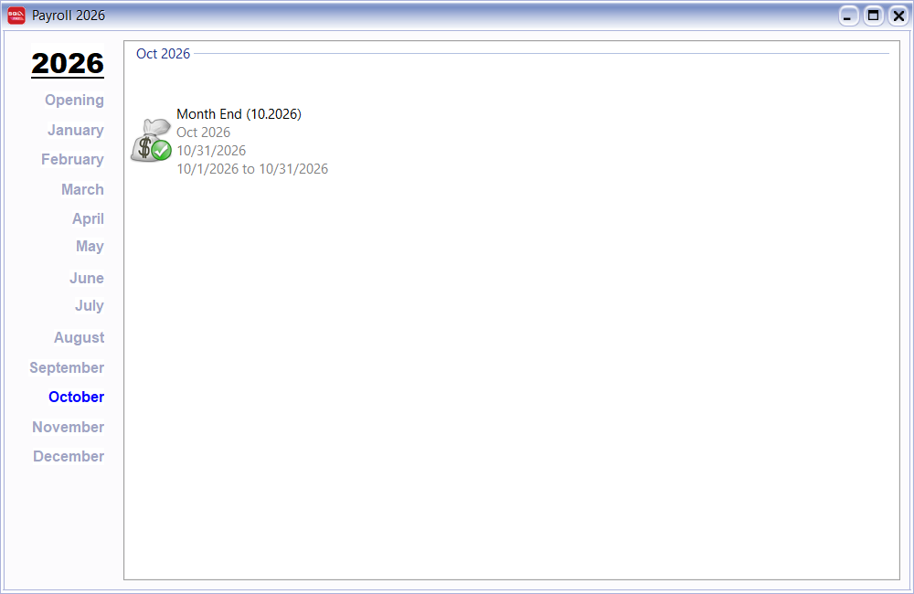

3. Double-click an employee's name to open the employee's paysheet.

    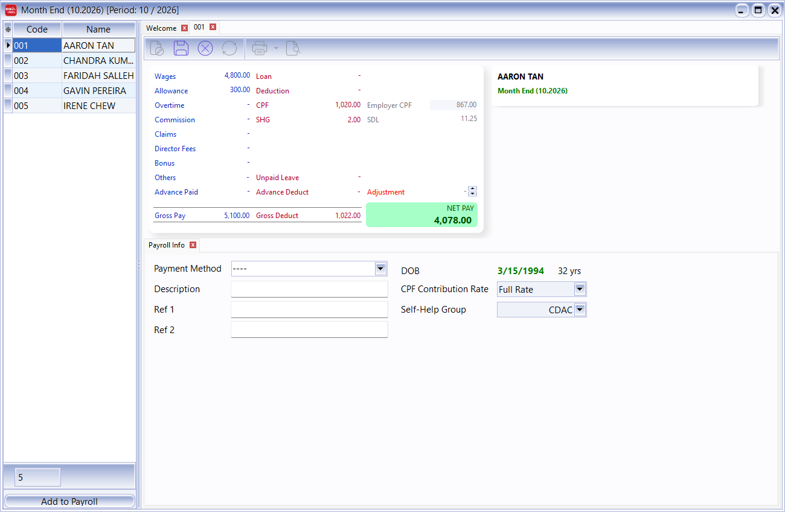

## 4 Enter Variable Payments and Deductions

Enter the month's additional payments and deductions in the employee's paysheet. If it is read-only, click **Edit**, the document and pencil icon on the paysheet toolbar.

The screenshots show all the sample entries completed. To save a change, leave the cell you are editing and click **Save**, the disk icon on the paysheet toolbar.

### 4.1 Allowance

Use **Allowance** to enter an additional allowance for this payroll.

1. Click **Allowance** in the paysheet summary.
2. Click **+** to add a row. Open the **Code** list and select the allowance. Check that **Description** matches the code you selected.
3. Check the dates, then enter **Work Unit** and **Rate**. For the Handphone allowance in the example, select **H01** and enter 1.00 work unit at a rate of 150.00.

    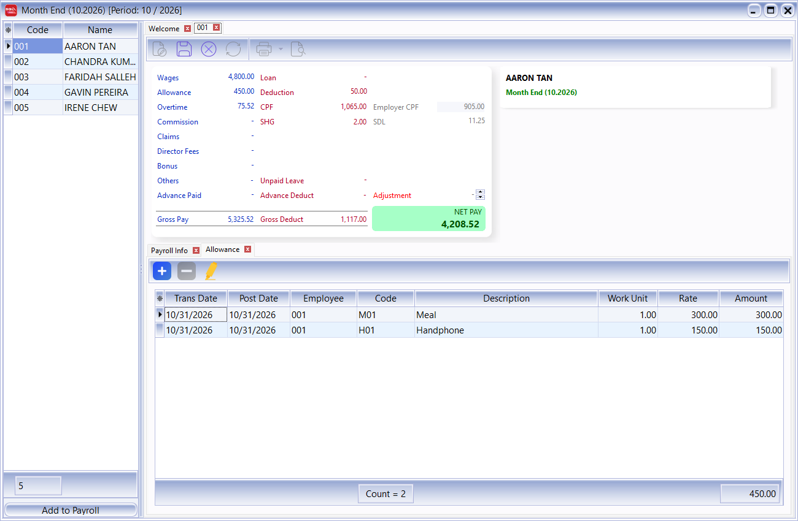

    | Field Name  | Definition                                            |
    | ----------- | ----------------------------------------------------- |
    | Trans Date  | Date of the allowance transaction.                    |
    | Post Date   | Posting date of the allowance transaction in payroll. |
    | Employee    | Employee code for the allowance transaction.          |
    | Code        | Allowance code selected from Maintain Allowance.      |
    | Description | Description of the allowance transaction.             |
    | Work Unit   | Number of allowance units payable.                    |
    | Rate        | Rate of allowance payable per work unit.              |
    | Amount      | Allowance amount calculated from Work Unit and Rate.  |

4. Click **Save**, then check the allowance total. The example has a $300.00 Meal allowance and a $150.00 Handphone allowance, for a total of $450.00.

### 4.2 Overtime

Record overtime for the payroll period under **Overtime**. First, check the employee's working hours and overtime settings in [Maintain Contribution](./sg-user-guide.md#42-maintain-contribution).

1. Click **Edit**, then click **Overtime** in the paysheet summary.
2. Click **+** and select the overtime **Code**. Check the description and rate for the code you selected.
3. Enter the overtime date and **Work Unit**. In the example, select **HWD** for **Working Day (Hourly x1.5)**, set **Trans Date** to 30 October 2026, and enter 2.00 work units for two hours.

    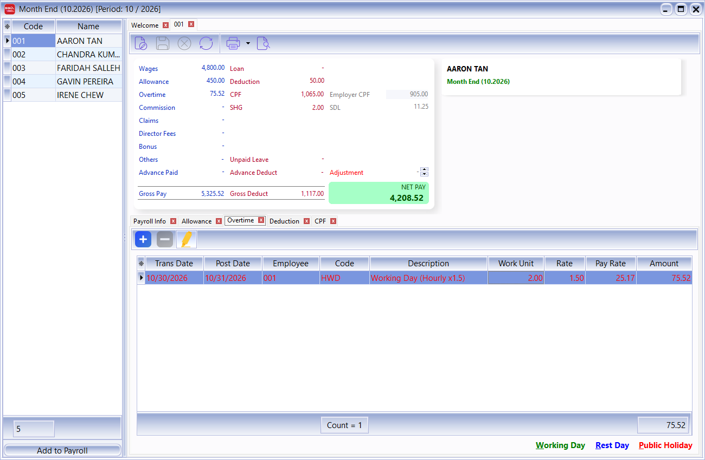

    | Field Name  | Definition                                                                               |
    | ----------- | ---------------------------------------------------------------------------------------- |
    | Trans Date  | Date on which the overtime was worked.                                                   |
    | Post Date   | Posting date of the overtime transaction in payroll.                                     |
    | Employee    | Employee code for the overtime transaction.                                              |
    | Code        | Overtime code selected from Maintain Overtime.                                           |
    | Description | Description of the overtime transaction.                                                 |
    | Work Unit   | Number of overtime units. For an Hourly overtime code, enter the number of hours.        |
    | Rate        | Overtime multiplier for the selected code. The example uses 1.50.                        |
    | Pay Rate    | Base pay rate used to calculate overtime, according to the employee's calculation setup. |
    | Amount      | Calculated overtime payment for the transaction.                                         |

4. Click **Save** and check **Amount**. Two hours gives $75.52 in this example. **Pay Rate** shows a rounded figure, so check the application's calculated amount.

### 4.3 Deduction

Enter approved pay deductions under **Deduction**. Choose a code whose contribution options match the deduction.

1. Click **Edit**, then click **Deduction** in the paysheet summary.
2. Click **+** and select the deduction **Code**. The example uses **R01** (Equipment Repayment), with all contribution options unchecked.
3. Check the dates, then enter **Work Unit** and **Rate**. The example uses 1.00 work unit at 50.00.

    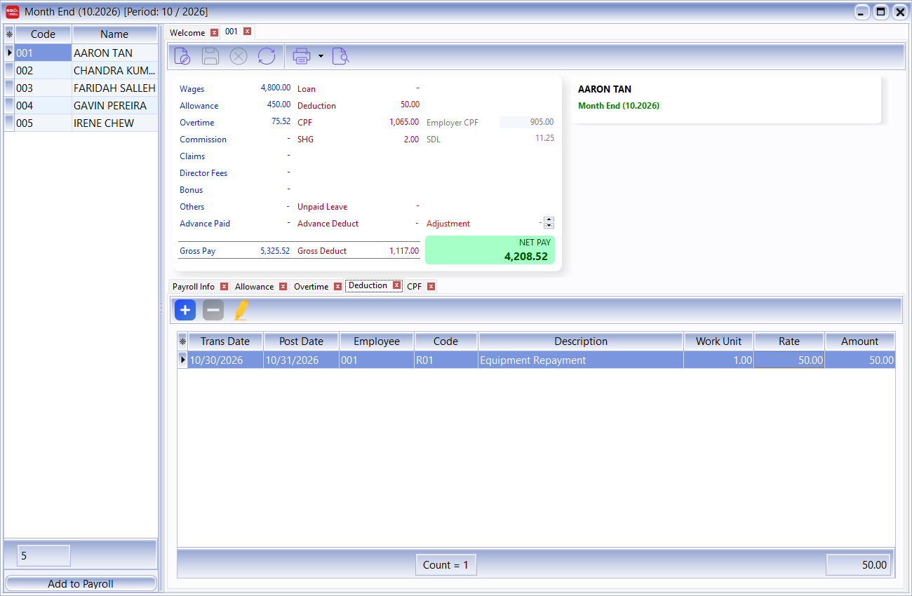

    | Field Name  | Definition                                            |
    | ----------- | ----------------------------------------------------- |
    | Trans Date  | Date of the deduction transaction.                    |
    | Post Date   | Posting date of the deduction transaction in payroll. |
    | Employee    | Employee code for the deduction transaction.          |
    | Code        | Deduction code selected from Maintain Deduction.      |
    | Description | Description of the deduction transaction.             |
    | Work Unit   | Number of deduction units.                            |
    | Rate        | Rate of deduction per work unit.                      |
    | Amount      | Deduction amount calculated from Work Unit and Rate.  |

4. Click **Save** and check the deduction total. The example deducts $50.00.

### 4.4 Correct an Entry

1. Open the saved payroll and double-click the employee's name.
2. Click **Edit** on the paysheet toolbar.
3. Click the item you need to change, such as **Allowance**, **Overtime**, or **Deduction**. Select the row and correct its code, dates, units, or rate.
4. Leave the edited cell and check the description and calculated amount, especially if you changed the code.
5. Click **Save**, then reopen the employee's paysheet to check that the changes were saved. Apply the payroll reports again to review the updated figures.

## 5 Review the Employee's Payroll

Check the paysheet summary and **Payroll Info** before preparing payslips.

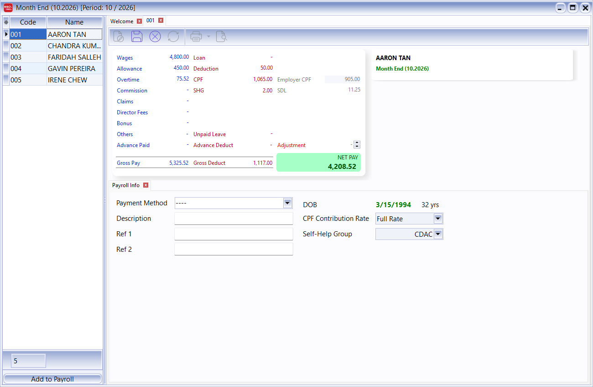

| Field Name   | Definition                                                                                                          |
| ------------ | ------------------------------------------------------------------------------------------------------------------- |
| Wages        | Employee's wages for this payroll.                                                                                  |
| Allowance    | Total allowances in this payroll.                                                                                   |
| Overtime     | Total overtime payments in this payroll.                                                                            |
| Deduction    | Total transactions entered under Deduction.                                                                         |
| CPF          | Employee's CPF contribution deducted from pay.                                                                      |
| Employer CPF | Employer's CPF contribution, shown separately from employee deductions.                                             |
| SHG          | Employee's contribution to the [Self-Help Group](./sg-user-guide.md#316-self-help-group) selected for the employee. |
| SDL          | Skills Development Levy payable by the employer, shown separately from employee deductions.                         |
| Gross Pay    | Total earnings shown in the paysheet.                                                                               |
| Gross Deduct | Total employee deductions, including employee CPF, SHG, and the deduction transactions.                             |
| NET PAY      | Take-home amount after deductions and any Adjustment.                                                               |

Aaron's completed payroll has these totals:

- **Gross Pay:** $4,800.00 wages + $450.00 allowances + $75.52 overtime = $5,325.52.
- **Gross Deduct:** $1,065.00 employee CPF + $2.00 SHG + $50.00 equipment repayment = $1,117.00.
- **NET PAY:** $5,325.52 − $1,117.00 = $4,208.52.
- **Employer CPF:** $905.00. **SDL:** $11.25. These employer contributions are separate from the employee's take-home pay.

In **Payroll Info**, check the employee's **Payment Method**, **CPF Contribution Rate**, and **Self-Help Group**. The amounts in the example depend on Aaron's details and contribution settings.

## 6 Review the Payroll Summary

Use **Payroll Summary** to check each employee's amounts and the totals for the whole payroll.

1. Navigate to **Payroll | Print Payroll Summary**.
2. Select **Payroll Summary** in **Report**. Check **Process** and select the payroll process from its list. Under **Group/Sort By**, check **Employee** to group the report by employee.
3. Click **Apply**. Check that the results tab shows the payroll process you selected.

    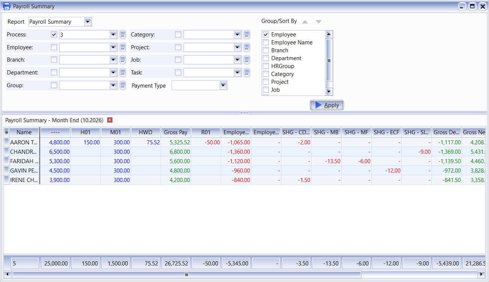

4. Click **Preview**, the document and magnifying glass icon on the main toolbar. In **Select Report**, choose a Singapore format, such as **PR.Summary.Grouped-L1.Report 1.SG**, and click **OK**.
5. Review the employee amounts and **Grand Total**.

    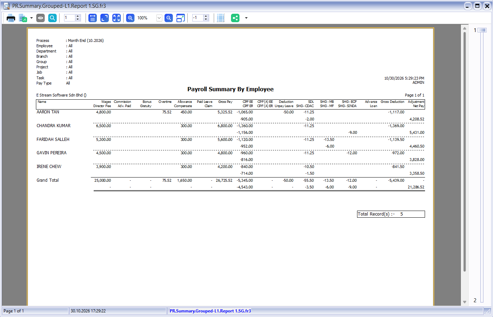

For the five sample employees, gross pay totals $26,725.52. Employee deductions are $5,439.00, leaving net pay of $21,286.52. Aaron's net pay is $4,208.52, the same as on his paysheet.

## 7 Prepare Payslips

1. Navigate to **Payroll | Print Payslip**.
2. Select the payroll in **Process**. To show fewer employees, use **Employee** or the other filters. Click **Apply**.

    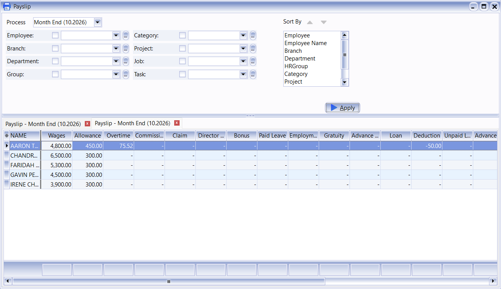

3. Click **Preview**, the document and magnifying glass icon on the main toolbar. Choose a format in **Select Report**. The example uses **PR.Payslip2A.Report.SG**.

    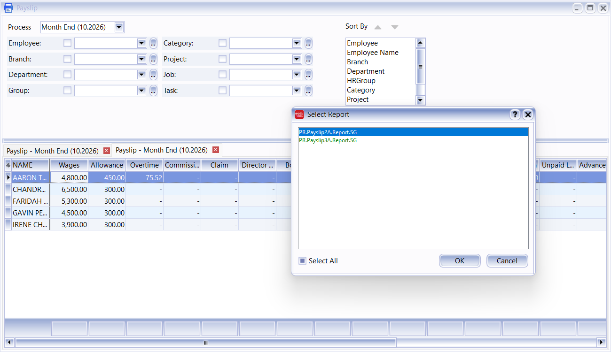

4. Click **OK**. Check the employee, period, earnings, deductions, employer contributions, and net pay in the preview.

    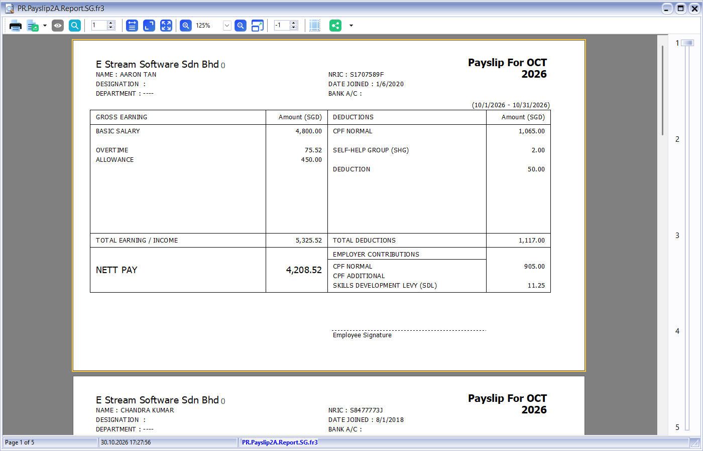

5. Once the figures are correct, click the printer icon in the preview to print the payslips.

If you change payroll after generating the report, click **Apply** again. Open a new preview to check the updated amounts.

## 8 Continue to Statutory Submission

After checking payroll, follow the [Statutory Submission guide](./sg-statutory-submission.md) to prepare the CPF, OED, or IR8A reports you need. Creating payroll and previewing payslips do not submit these reports.
