## 1 SQL Payroll Modules

:::info
SQL Payroll software is built from ground up around Payroll Process. You can easily process and print from one to hundreds of employee's pay slip with just a few mouse click. What's more is that you can virtually keep unlimited payroll history and have your data safe and sound with strong security and data protection.
:::

SQL Payroll consists of 3 main modules:

1. Human Resource
2. Payroll
3. Leave

#### Human Resouce Setup

| Module                                             | Description                                                           |
| ---------------------------------------------------| ----------------------------------------------------------------------|
| [**Maintain Employee**](#31-maintain-employee)     | Define the biodata of employees                                       |
| [**Maintain Branch**](#32-maintain-branch)         | Define the branch name, eg. HQ, branch A, B, C, etc                   |
| [**Maintain Department**](#33-maintain-department) | Define the department, eg. Accounts, Sales, Production, etc           |
| [**Maintain Group**](#34-maintain-group)           | Define the group level, eg. Director, Manager, Executive, Clerk, etc  |
| [**Maintain Category**](#35-maintain-category)     | Define the category of employees, eg. local, expatriate (移居国外),etc |
| [**Maintain Project**](#36-maintain-project)       | Define the project                                                    |
| [**Maintain Job**](#37-maintain-job)               | Define the job; he/she will be handled, eg. Accounts Receivable       | 
| [**Maintain Task**](#38-maintain-task)             | Define the task; he/she will be covered, eg. collection & billing     |
| [**Maintain Race**](#39-maintain-race)             | Define the races, eg. Malay, Chinese, Indian, etc                     |

#### Payroll Setup

| Module                                                     | Description                                                                              |
| -----------------------------------------------------------| ---------------------------------------------------------------------------------------- |
| [**Maintain Allowance**](#43-maintain-allowance)           | Define the allowance rate and contribution                                               |
| [**Maintain Claims**](#46-maintain-claim)                  | Define the claims type, rate and limit                                                   |
| [**Maintain Commission**](#47-maintain-commission)         | Define the commission rate and contribution                                              |
| [**Maintain Contribution**](#42-maintain-contribution)     | Enable to set Permanent Residence CPF rates, OT calculation settings and contribution    |
| [**Maintain Deduction**](#44-maintain-deduction)           | Define the deduction type, rate and contribution                                         |
| [**Maintain Overtime**](#45-maintain-overtime)             | Define the overtime type, rate, unit type, and contribution                              |
| [**Maintain Payment Method**](#48-maintain-payment-method) | Define the bank information                                                              |
| [**Maintain Wages**](#41-maintain-wages)                   | Enable to set different contribution on Wages, such as CPF, SHG, SDL and IR8A            |

## 2 Getting Started SQL Payroll System

### 2.1 Setting up Company Profile

1. **File | Company Profile**

    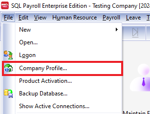

2. Complete the **General** Section.

    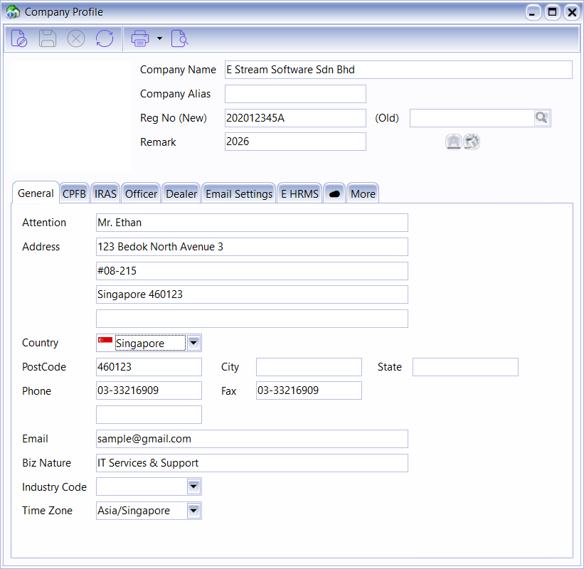

3. Complete the **CPFB** Section. The **CPF Submission No.** will be captured in CPF EZPay submission file.

    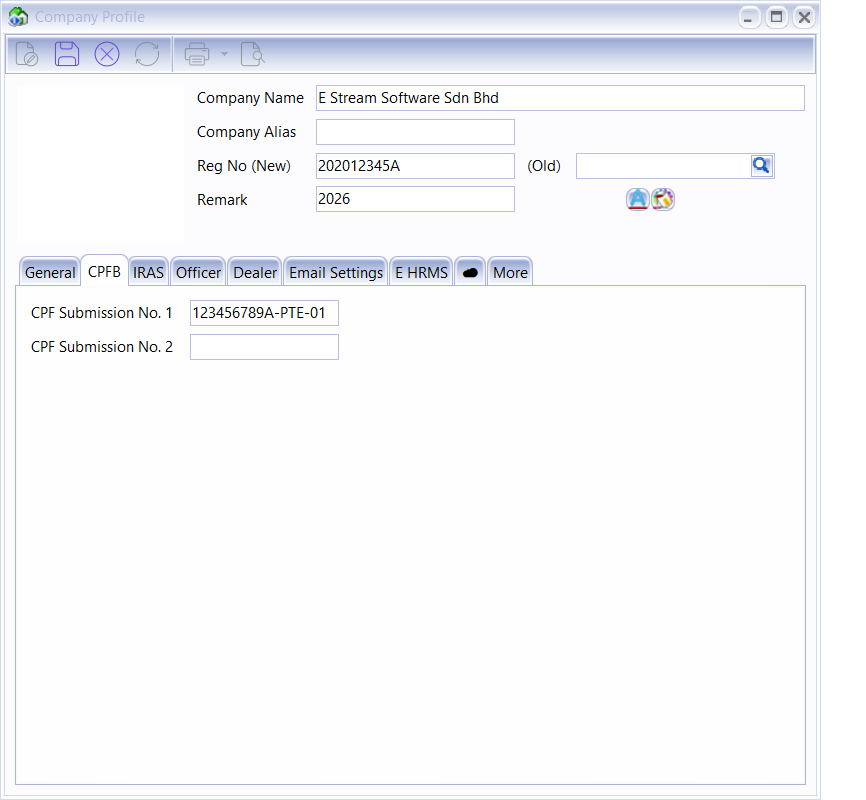

4. Complete the **Officer** Section.

    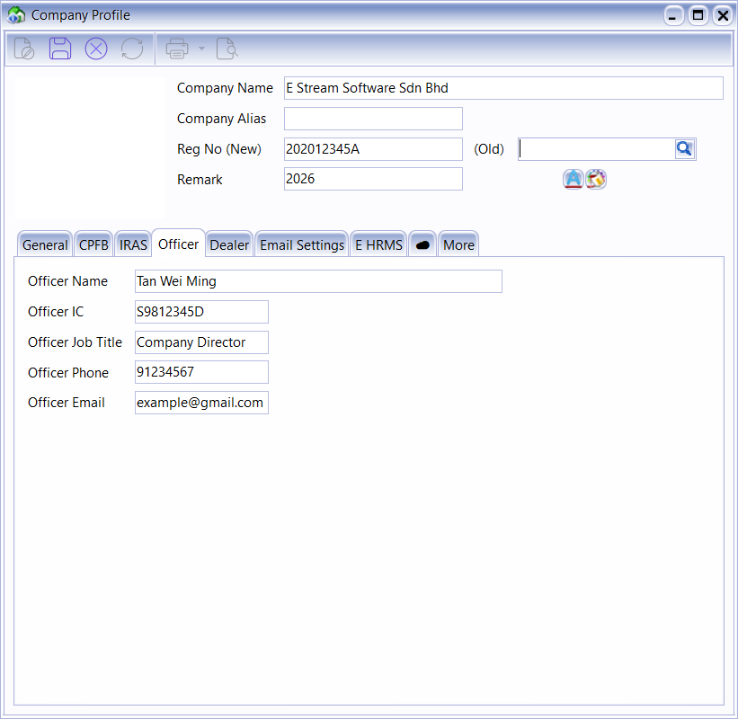
    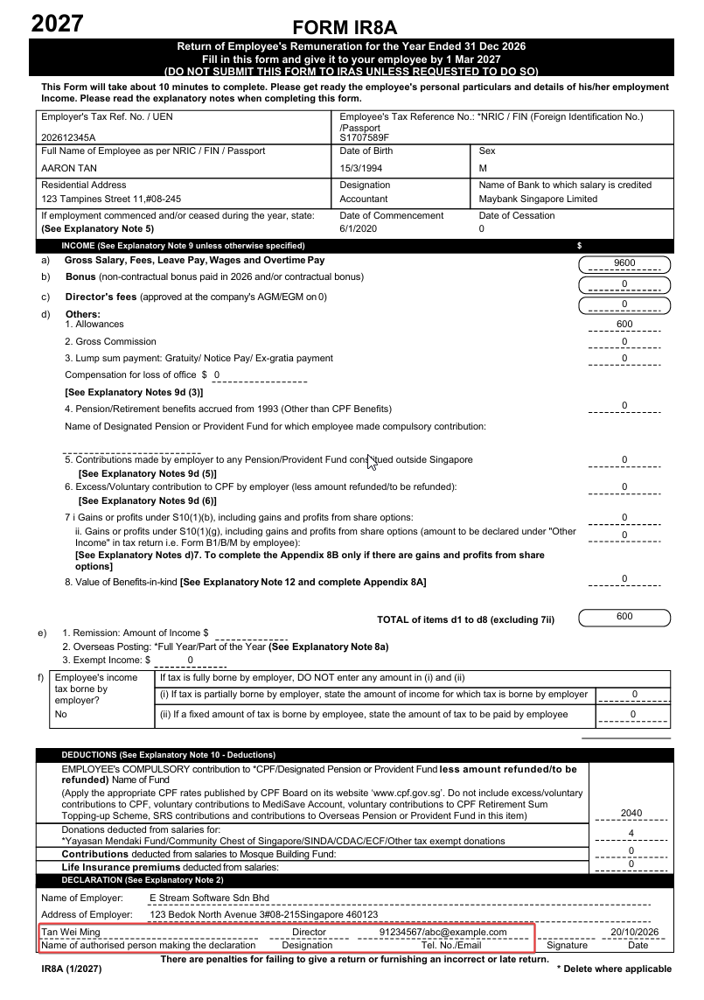

## 3 Human Resource Setup

### 3.1 Maintain Employee

1. Navigate to the Maintain Employee panel.

    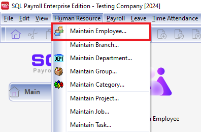

   **OR Click on "Maintain Employee" on the home page.**

    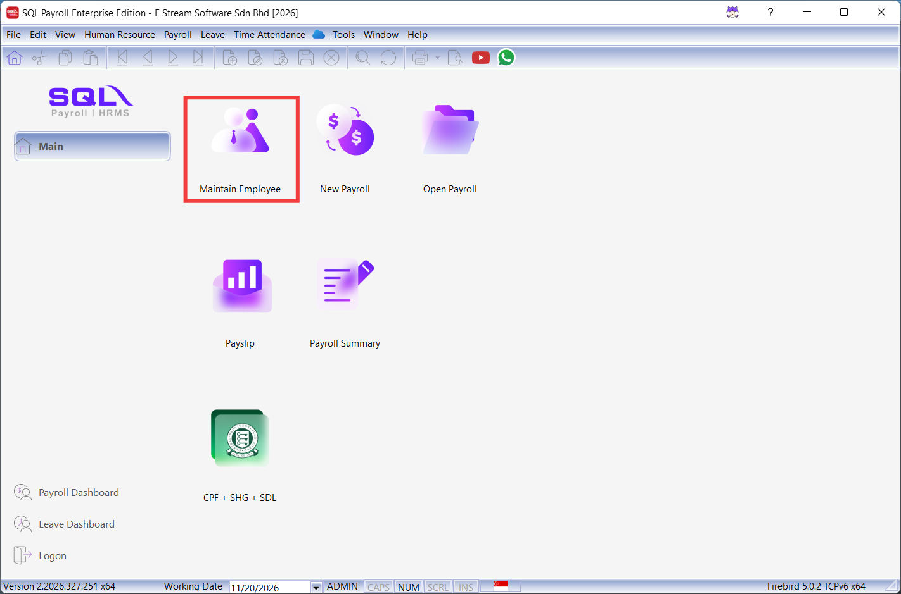

2. Click New to create a new employee.

    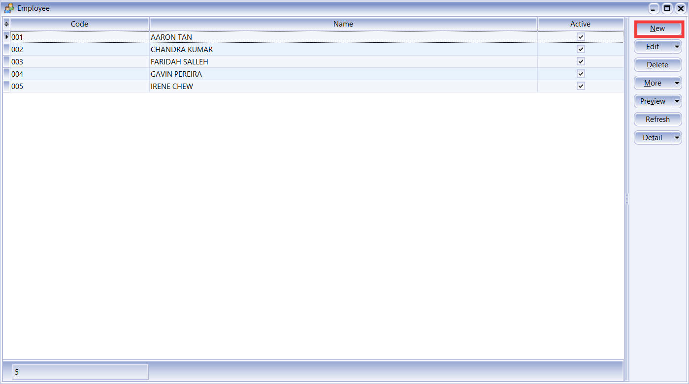

#### 3.1.1 Personal

This tab is used to store employee personal info. 

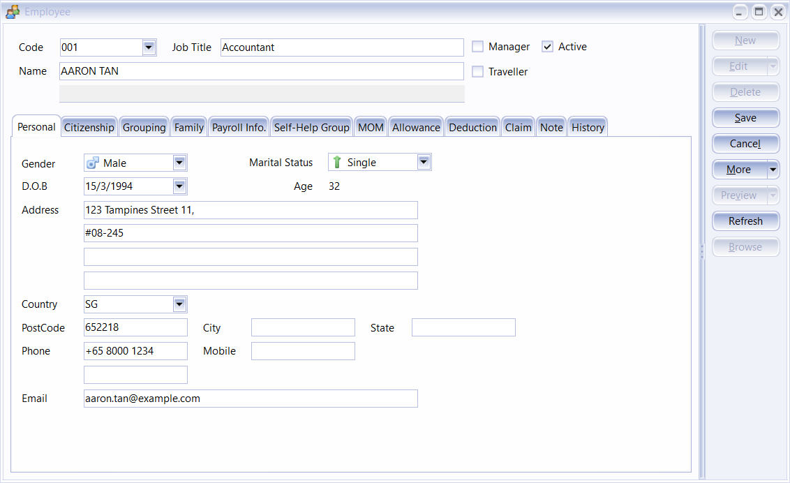

| Field Name        | Definition                                                                                     |
| ------------------| -----------------------------------------------------------------------------------------------|
| Code              | Employee Code                                                                                  |
| Job Title         | Employee Job Title                                                                             |
| Name              | Full Employee Name                                                                             |
| Active            | Unchecked if the selected employee is resigned.                                                |
| Gender            | The Employee Sex                                                                               |
| Marital Status    | The Employee Marriage Status                                                                   |
| D.O.B             | The Employee Date of Birth                                                                     |
| Address           | Employee Correspondence Address                                                                |
| Country           | Country of the Employee Correspondence Address                                                 |
| PostCode          | Postcode of the Employee Correspondence Address                                                |
| City              | City of the Employee Correspondence Address                                                    |
| State             | State of the Employee Correspondence Address                                                   |
| Phone             | Employee Correspondence Phone Number                                                           |
| Mobile            | Employee Handphone Number                                                                      |
| Email             | Employee E-Mail Address                                                                        |

#### 3.1.2 Citizenship

This tab is used to store employee citizenship info. 

    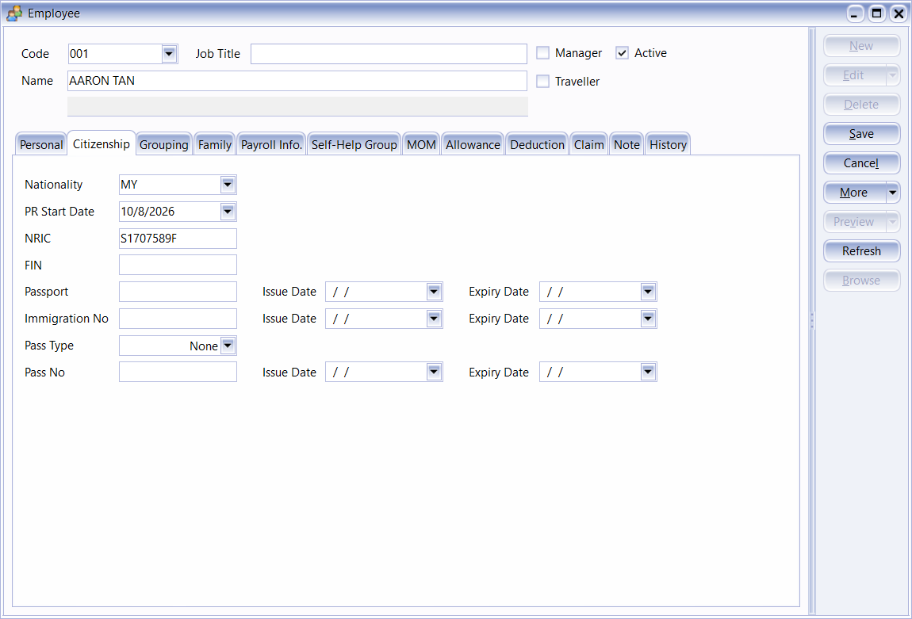

| Field Name              | Definition                                                                                                                 |
| ------------------------| ---------------------------------------------------------------------------------------------------------------------------|
| Nationality             | Employee Nationality                                                                                                       |
| PR Start Date           | Date of Employee granted Permanent Resident status in Singapore                                                            |
| NRIC                    | Employee NRIC                                                                                                              |
| FIN                     | Foreign Identification Number for Foreign Employee                                                                         |
| Passport                | Employee Passport Number                                                                                                   |
| Passport Issue Date     | Employee Passport Issue Date                                                                                               |
| Passport Expiry Date    | Employee Passport Expiry Date                                                                                              |
| Immigration No          | Employee Immigration Number                                                                                                |
| Immigration Issue Date  | Employee Immigration Issue Date                                                                                            |
| Immigration Expiry Date | Employee Immigration Expiry Date                                                                                           |
| Pass Type               | Select Foreign Employee Work Pass Type  1. None 2. Employment Pass  3. S Pass  4. Work Permit 5. Other |                                                                 
| Pass No                 | Employee Work Pass Number                                                                                                  |
| Pass Issue Date         | Employee Work Pass Issue Date                                                                                              |
| Pass Expiry Date        | Employee Work Pass Expiry Date                                                                                             |

#### 3.1.3 Grouping

This tab is used for report grouping for the selected employee. It can be organized by:

    - [Branch](#32-maintain-branch)
    - [HR Group](#34-maintain-group)
    - [Department](#33-maintain-department)
    - [Category](#35-maintain-category)
    - [Project](#36-maintain-project)
    - [Job](#37-maintain-job)
    - [Task](#38-maintain-task)
    - [Race](#39-maintain-race)

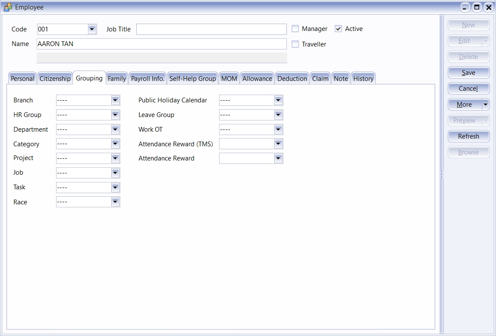

#### 3.1.4 Family

This tab is used to store spouse/family information. It is useful for emergency contact purposes.

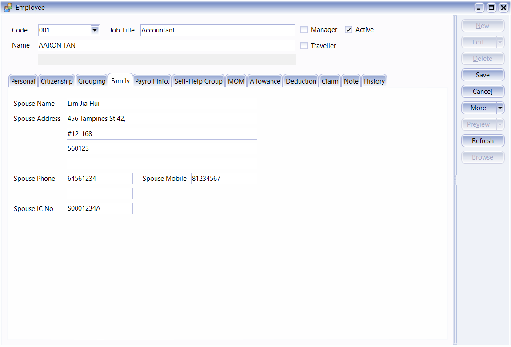

| Field Name        | Definition                                                                                     |
| ------------------| -----------------------------------------------------------------------------------------------|
| Spouse Name       | Employee Code                                                                                  |
| Spouse Address    | Employee Job Title                                                                             |
| Spouse Phone      | Full Employee Name                                                                             |
| Spouse Mobile     | Unchecked if the selected employee is resigned.                                                |
| Spouse IC No      | The Employee Sex                                                                               |
| Marital Status    | The Employee Marriage Status                                                                   |
| D.O.B             | The Employee Date of Birth                                                                     |
| Address           | Employee Correspondence Address                                                                |
| Country           | Country of the Employee Correspondence Address                                                 |
| PostCode          | Postcode of the Employee Correspondence Address                                                |

#### 3.1.5 Payroll Info

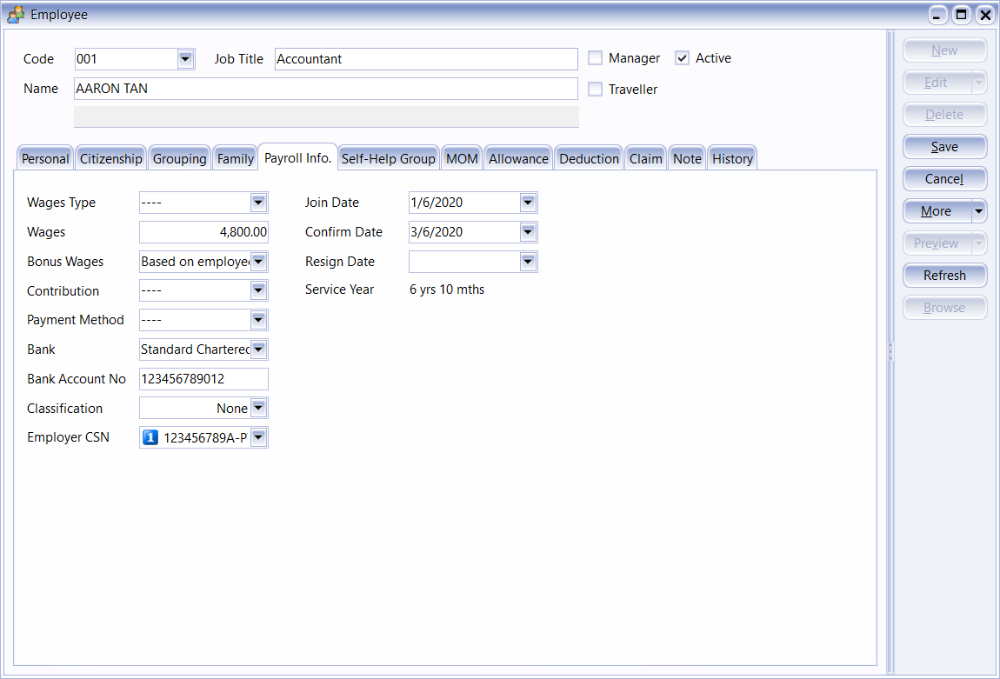

| Field Name        | Definition                                                                                     |
| ------------------| -----------------------------------------------------------------------------------------------|
| Wages Type        | Employee [Wages](#41-maintain-wages) Category Type                                             |
| Wages             | Employee wages amount                                                                          |
| Contribution      | Employee [Contribution](#42-maintain-contribution) Type                                        |
| Payment Method    | Employee [Payment Method](#48-maintain-payment-method)                                         |
| Bank              | Employee Bank                                                                                  |
| Bank Account No   | Employee Bank Account Number                                                                   |
| Classification    | Choose Employee Job Classification  1. None  2. Non-workman  3. Workman            |
| Employer CSN      | Employer CSN under which the employee’s CPF contributions are submitted.                       |
| Join Date         | Employee Join Company Date                                                                     |
| Confirm Date      | Employee Confirmation Date                                                                     |
| Resign Date       | Employee Resign Date                                                                           |

#### 3.1.6 Self-Help Group

This tab is used to select the Self-Help Group applicable to the employee for contribution purpose.

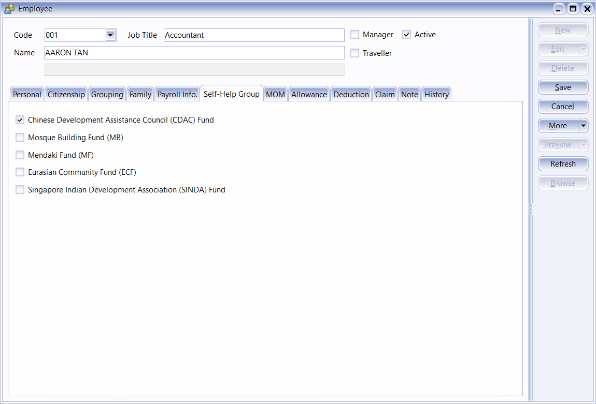

#### 3.1.7 MOM

This tab is used to store the employee info required for submission to the Ministry of Manpower’s Occupational Employment Dataset (OED).

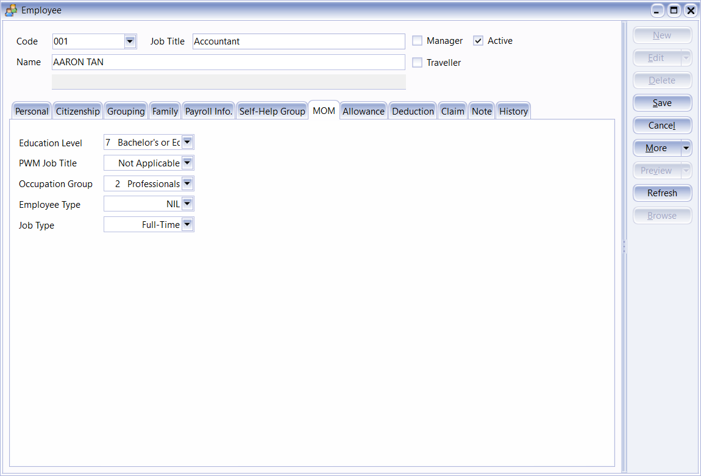

| Field Name        | Definition                                                                                     |
| ------------------| -----------------------------------------------------------------------------------------------|
| Education Level   | Select the employee highest education level                                                    |
| PWM Job Title     | Select the Progressive Wage Model job title applicable to the employee                         |
| Occupation Group  | Select the Occupation Group applicable to the employee                                         |
| Employee Type     | Select the employee type applicable to the employee                                            |
| Job Type          | Select the job type applicable to the employee (eg. Full-time, Part-Time)                      |

#### 3.1.8 Allowance

Use this tab to enter the Fixed Allowance entitled for each month for the selected employee.

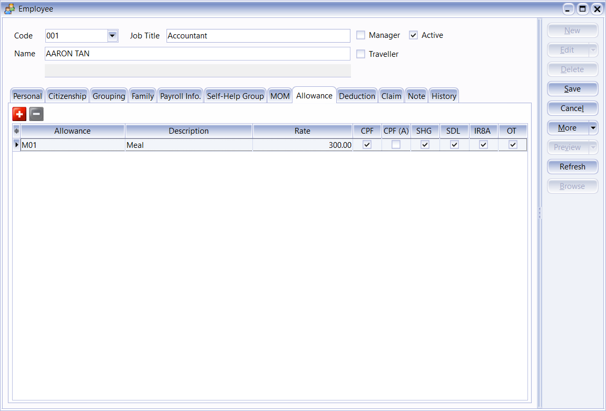

#### 3.1.9 Deduction

Use this tab to enter the Fixed Deduction entitled for each month for the selected employee.

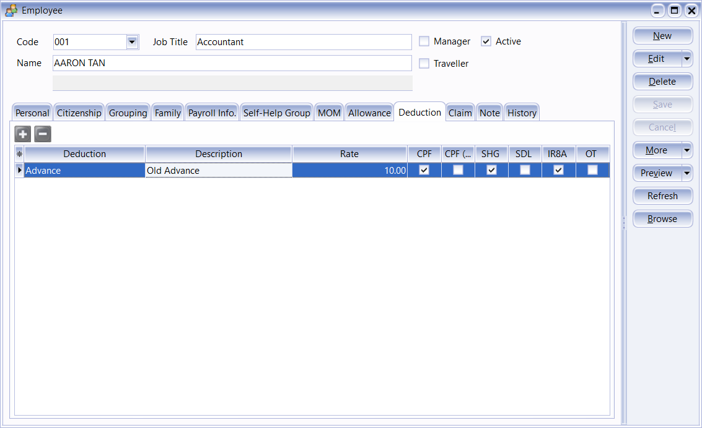

#### 3.1.10 Claim 

Use this tab to enter the Claim available to the employee.

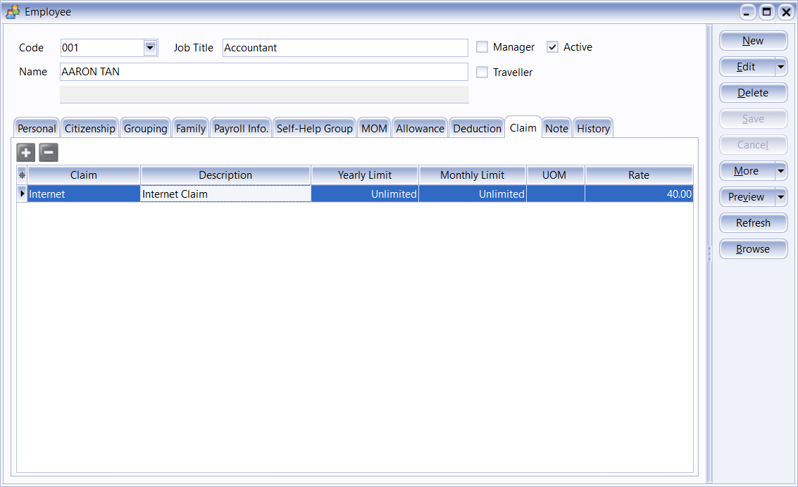 

#### 3.1.11 Note

Use this tab to upload a photo and other information for the selected employee.

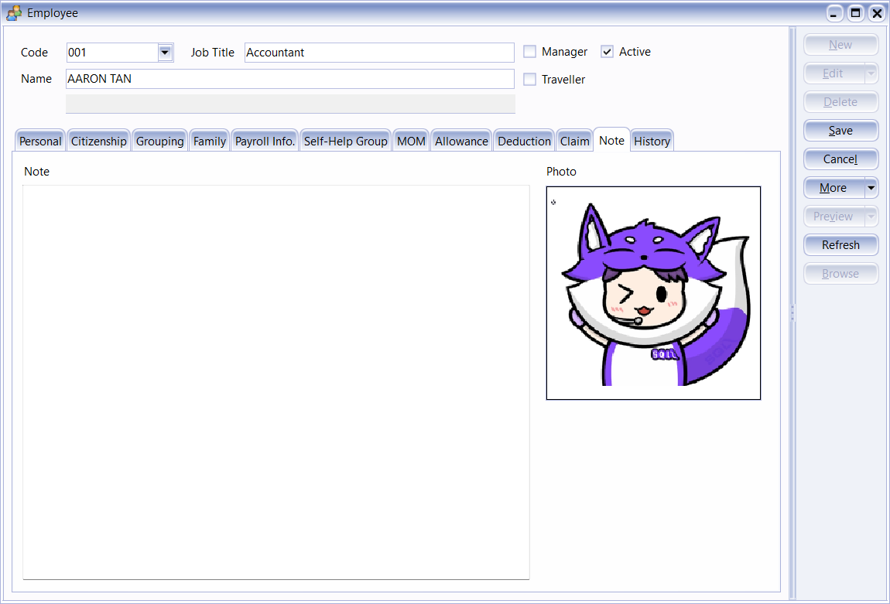 

#### 3.1.12 History

This tab shows the history of changes for the selected employee.

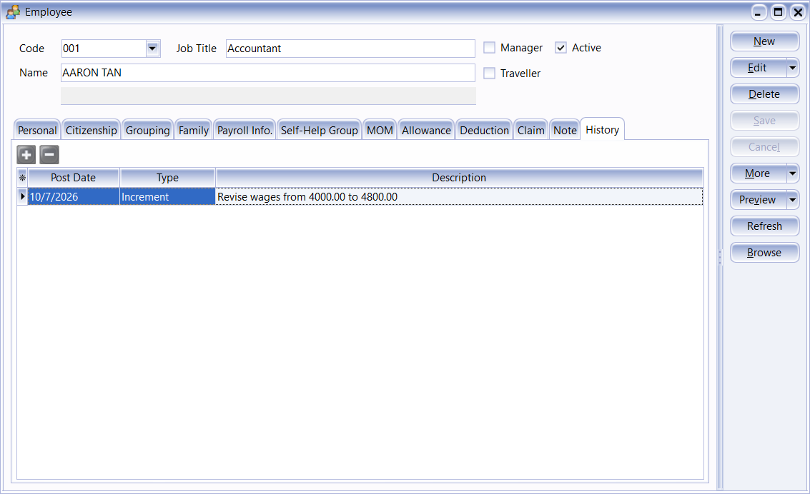 

### 3.2 Maintain Branch

This is useful for companies with multiple branches where the salary is paid from HQ.

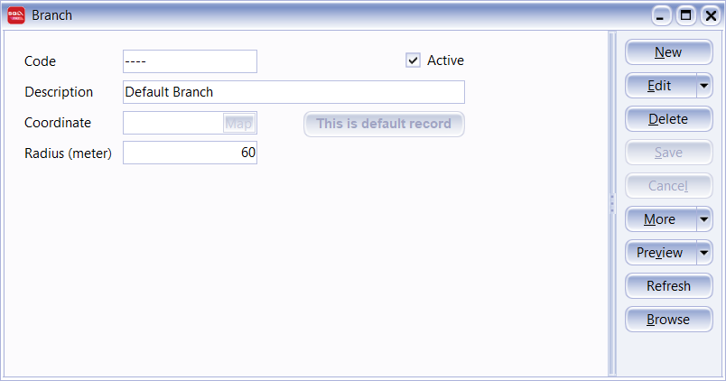

| Field Name        | Definition                                                                                                    |
| ------------------| --------------------------------------------------------------------------------------------------------------|
| Code              | A Branch Code (Max 20 Characters)                                                                             |
| Description       | A Full Description for Branch (Max 160 Characters)                                                            |
| Active            | Uncheck if the selected Branch code is unavailable                                                            |
| Set as Default    | Click this button to automatically assign this Branch Code when creating a new employee at Maintain Employee  |
| Coordinate        | Coordinate of Branch                                                                                          |
| Radius            | Radius of Branch                                                                                              |

### 3.3 Maintain Department

A division of an organization, such as Accounts, Marketing, etc.

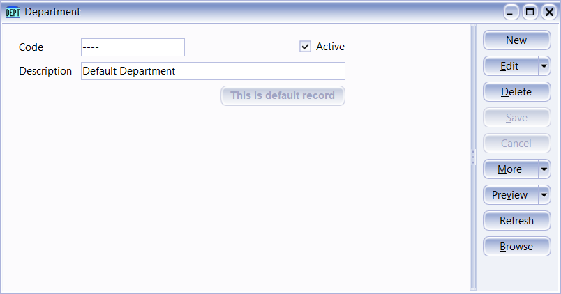

| Field Name        | Definition                                                                                                        |
| ------------------| ------------------------------------------------------------------------------------------------------------------|
| Code              | A Department Code (Max 20 Characters)                                                                             |
| Description       | A Full Description for Department (Max 160 Characters)                                                            |
| Active            | Uncheck if the selected Department code is unavailable                                                            |
| Set as Default    | Click this button to automatically assign this Department Code when creating a new employee at Maintain Employee  |

### 3.4 Maintain Group

Another method for grouping employees in reports.

| Field Name        | Definition                                                                                                   |
| ------------------| -------------------------------------------------------------------------------------------------------------|
| Code              | A Group Code (Max 20 Characters)                                                                             |
| Description       | A Full Description for Group (Max 160 Characters)                                                            |
| Active            | Uncheck if the selected Group code is unavailable                                                            |
| Set as Default    | Click this button to automatically assign this Group Code when creating a new employee at Maintain Employee  |

### 3.5 Maintain Category

Divide employees by class or division.

| Field Name        | Definition                                                                                                      |
| ------------------| ----------------------------------------------------------------------------------------------------------------|
| Code              | A Category Code (Max 20 Characters)                                                                             |
| Description       | A Full Description for Category (Max 160 Characters)                                                            |
| Active            | Uncheck if the selected Category code is unavailable                                                            |
| Set as Default    | Click this button to automatically assign this Category Code when creating a new employee at Maintain Employee  |

### 3.6 Maintain Project

Group employees by the project they are working on.

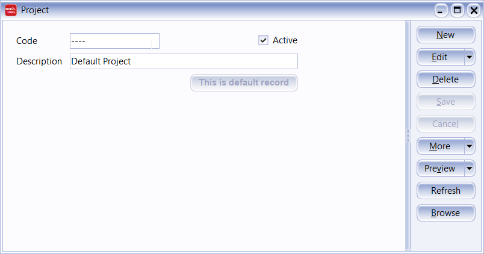

| Field Name        | Definition                                                                                                     |
| ------------------| ---------------------------------------------------------------------------------------------------------------|
| Code              | A Project Code (Max 20 Characters)                                                                             |
| Description       | A Full Description for Project (Max 160 Characters)                                                            |
| Active            | Uncheck if the selected Project code is unavailable                                                            |
| Set as Default    | Click this button to automatically assign this Project Code when creating a new employee at Maintain Employee  |

### 3.7 Maintain Job

Group employees by job type for reporting.

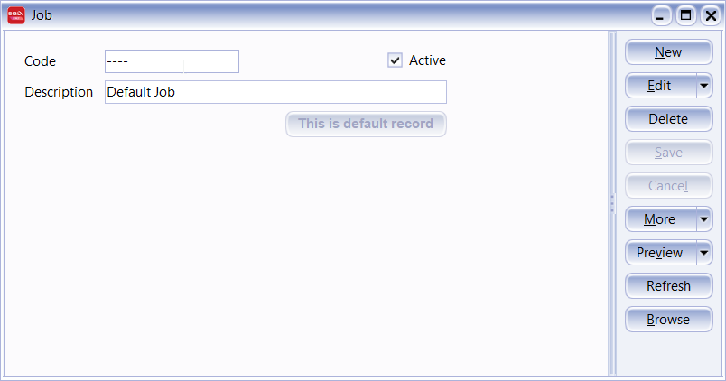

| Field Name        | Definition                                                                                                 |
| ------------------| -----------------------------------------------------------------------------------------------------------|
| Code              | A Job Code (Max 20 Characters)                                                                             |
| Description       | A Full Description for Job (Max 160 Characters)                                                            |
| Active            | Uncheck if the selected Job code is unavailable                                                            |
| Set as Default    | Click this button to automatically assign this Job Code when creating a new employee at Maintain Employee  |

### 3.8 Maintain Task

Divide employees by specific tasks.

| Field Name        | Definition                                                                                                  |
| ------------------| ------------------------------------------------------------------------------------------------------------|
| Code              | A Task Code (Max 20 Characters)                                                                             |
| Description       | A Full Description for Task (Max 160 Characters)                                                            |
| Active            | Uncheck if the selected Task code is unavailable                                                            |
| Set as Default    | Click this button to automatically assign this Task Code when creating a new employee at Maintain Employee  |

### 3.9 Maintain Race

Group employees by race for reporting.

| Field Name        | Definition                                                                                                  |
| ------------------| ------------------------------------------------------------------------------------------------------------|
| Code              | A Race Code (Max 20 Characters)                                                                             |
| Description       | A Full Description for Race (Max 160 Characters)                                                            |
| Active            | Uncheck if the selected Race code is unavailable                                                            |
| Set as Default    | Click this button to automatically assign this Race Code when creating a new employee at Maintain Employee  |

### 3.10 Maintain History Type

Allows users to group changes made in Maintain Employee.

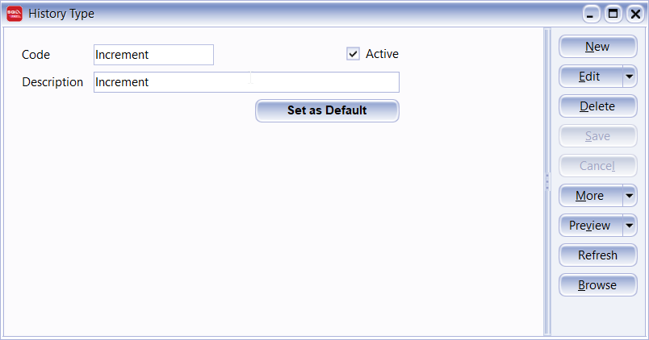

| Field Name        | Definition                                                                                                          |
| ------------------| --------------------------------------------------------------------------------------------------------------------|
| Code              | A History Type Code (Max 20 Characters)                                                                             |
| Description       | A Full Description for History Type (Max 160 Characters)                                                            |
| Active            | Uncheck if the selected History Type code is unavailable                                                            |
| Set as Default    | Click this button to automatically assign this History Type Code when creating a new employee at Maintain Employee  |

### 3.11 Maintain Announcement

Used to create, manage, and distribute company-wide or employee-specific announcements within the payroll and HR system, allowing users to share information, updates, or important reminders with their team.

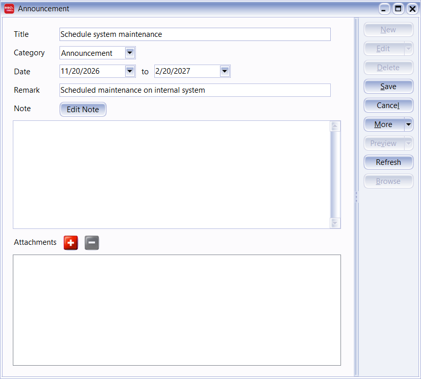

| Field Name        | Definition                                                                                                          |
| ------------------| --------------------------------------------------------------------------------------------------------------------|
| Title             | The title or subject of the announcement                                                                            |
| Date From         | The start date when the announcement becomes active                                                                 |
| Date To           | The end date when the announcement expires or becomes inactive.                                                     |
| Category          | The classification or type of announcement (e.g., General, System Update, Event).                                   |
| Remark            | Additional notes or comments related to the announcement.                                                           |

## 4 Payroll Setup

### 4.1 Maintain Wages

- Setting up Maintain Wages helps you categorize the type of wages an employee receives.
- This affects the types of contributions required and statutory reporting.
- This is especially useful if you have different types of workers such as permanent workers, contract workers, foreign workers, etc.

1. Navigate to **Payroll** > **Maintenance** > **Maintain Wages**

    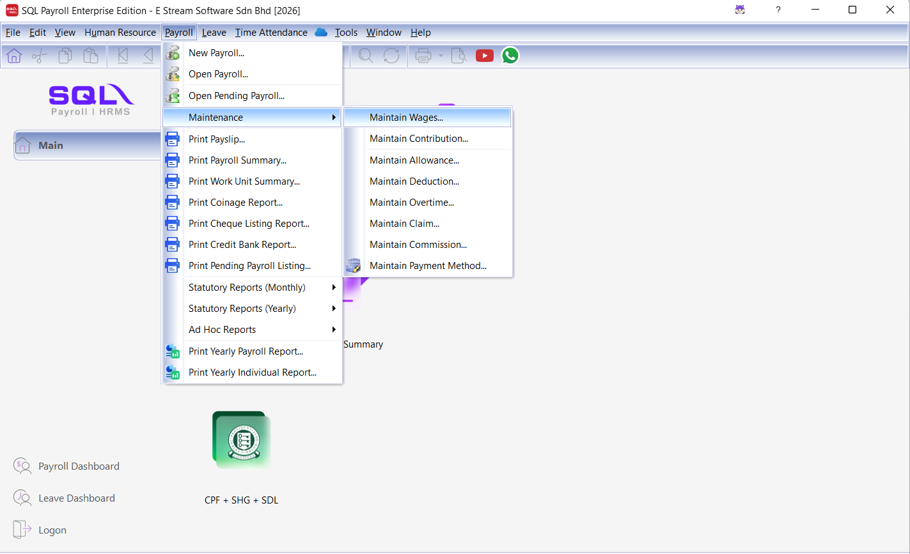

2. Click **New** to create new wages type.

    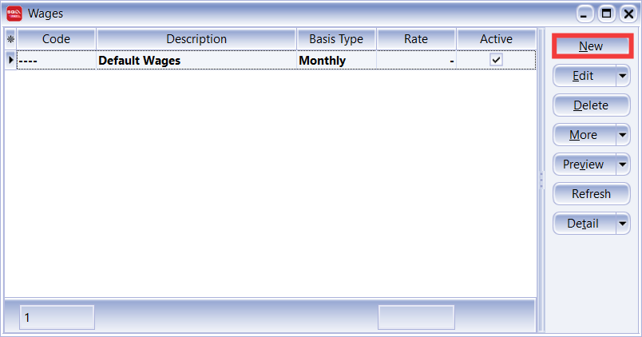

3. Enter the information and check the required contribution.

    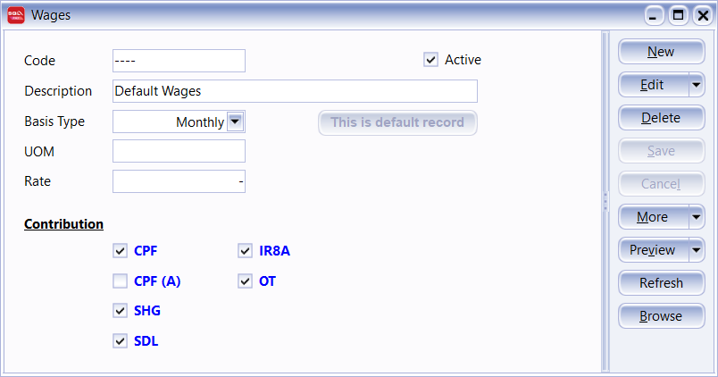

    | Field Name        | Definition                                                                                                                              |
    | ------------------| ----------------------------------------------------------------------------------------------------------------------------------------|
    | Code              | A Wage Code (Max 20 Characters)                                                                                                         |
    | Description       | A Full Description for Wage Type (Max 160 Characters)                                                                                   |
    | Basis Type        | Basis for calculation of employee basic wage. (eg. Monthly, Daily)                                                                      |
    | UOM               | Serve no purpose, for remark only.                                                                                                      |
    | Rate              | Rate of wage payable.                                                                                                                   |
    | Active            | Uncheck if the selected Wages Type code is unavailable                                                                                  |
    | Set as Default    | Click this button to automatically assign this Wage Type Code when creating a new employee at [Maintain Employee](#31-maintain-employee)|
    | CPF               | Contribution to Ordinary Wages of Central Provident Fund (CPF)                                                                          |
    | CPF (A)           | Contribution to Additional Wages of Central Provident Fund (CPF)                                                                        |
    | SHG               | Contribution to Self Help Group of employee selected in Employee [Self-Help Group](#316-self-help-group) tab                            |
    | SDL               | Contribution to Skill Development Levy of employee                                                                                      |
    | IR8A              | Report the wages of employee selected with this wage type in IR8A Form                                                                  |
    | OT                | Allow the amount to contribute to Overtime (OT)                                                                                         |

#### 4.1.1 Common Wages Setup

    | Citizen and Permanent Resident Workers                 | Foreign Workers                                        |
    |--------------------------------------------------------|--------------------------------------------------------|
    | 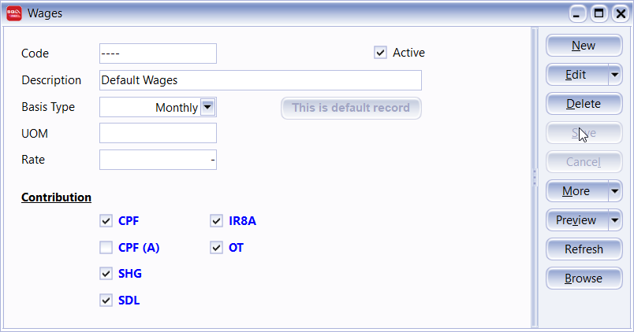 | 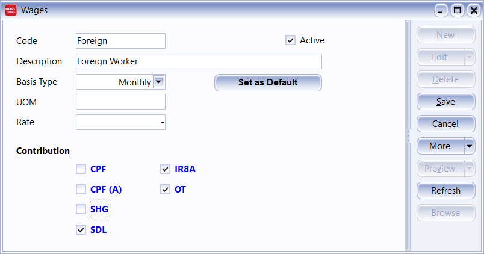 |

### 4.2 Maintain Contribution

:::info
Learn how to set the Permanent Resident CPF rate and OT calculation following this guide.
:::

- Setting up Maintain Contribution helps you categorize the type of contribution an employee receives.
- This affects the types of contributions required.

1. Navigate to **Payroll** > **Maintenance** > **Maintain Contribution**

    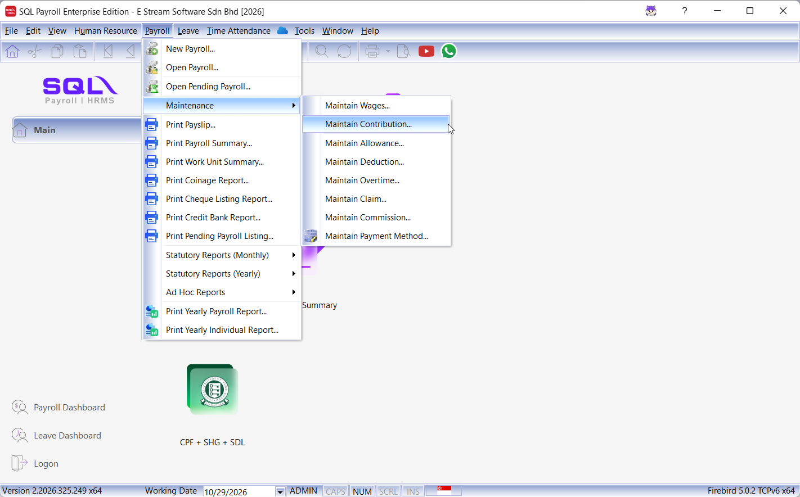 

2. Click **New** to create new contribution type.

    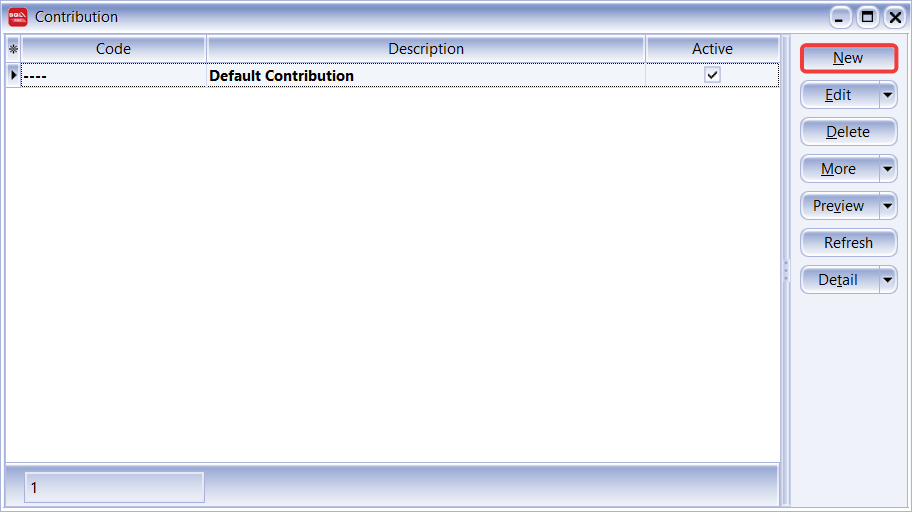  

#### 4.2.1 General

This tab is used for setting the Employee/Employer CPF rate and OT calculation.

:::info
System calculate Hourly OT Rate of Employee by:  
Daily Basis = Daily Basic Wage ÷ Working Hour Per Day  
Monthly Basis = 12 × Monthly Basic Wage ÷ 52 × Working Hour Per Week  
Monthly Basis on Rest Day = 12 × Monthly Basic Wage ÷ 52 × Working Day Per Week 
:::

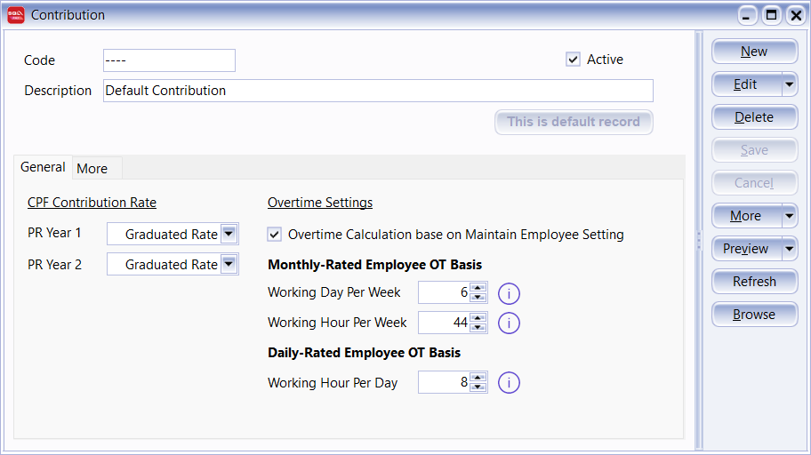

| Field Name                                             | Definition                                                                                                                                  |
| -------------------------------------------------------| --------------------------------------------------------------------------------------------------------------------------------------------|
| Code                                                   | A Contribution Code (Max 20 Characters)                                                                                                     |
| Description                                            | A Full Description for Contribution (Max 160 Characters)                                                                                    |
| Active                                                 | Uncheck if the selected Contribution code is unavailable                                                                                    |
| Set as Default                                         | Click this button to automatically assign this Contribution Code when creating a new employee at [Maintain Employee](#31-maintain-employee) |
| PR Year 1                                              | The CPF Contribution Rate applicable to Employee and Employer during Employee First Year of Permanent Resident status, associated with the CPF Table (eg. Full Rate, Graduated Rate) |
| PR Year 2                                              | The CPF Contribution Rate applicable to Employee and Employer during Employee Second Year of Permanent Resident status, associated with the CPF Table (eg. Full Rate, Graduated Rate)|
| Overtime Calculation base on Maintain Employee Setting | Check this to auto calculate the OT amount. If uncheck, OT amount will need to manually input after process month end.                      |
| Working Day Per Week                                   | Number of working days in a week                                                                                                            |
| Working Hour Per Week                                  | Number of working hours in a week                                                                                                           |
| Working Hour Per Day                                   | Number of working hours in a day                                                                                                            |

#### 4.2.2 More

This tab is used to check the contribution required.

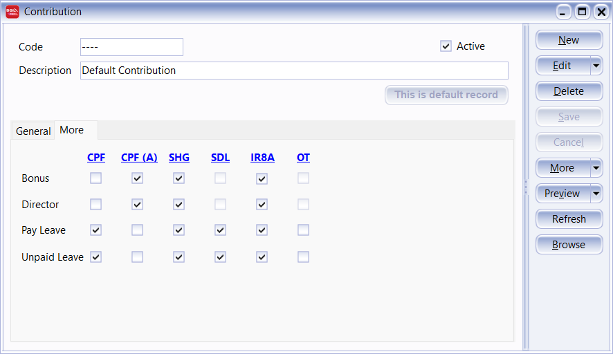

| Field Name        | Definition                                                                                                                              |
| ------------------| ----------------------------------------------------------------------------------------------------------------------------------------|
| CPF               | Contribute to Ordinary Wages of Central Provident Fund (CPF)                                                                            |
| CPF (A)           | Contribute to Additional Wages of Central Provident Fund (CPF)                                                                          |
| SHG               | Contribute to Self Help Group of employee selected in Employee [Self-Help Group](#316-self-help-group) tab                              |
| SDL               | Contribute to Skill Development Levy of employee                                                                                        |
| IR8A              | Report to IR8A Form                                                                                                                     |
| OT                | Allow the amount to contribute to Overtime (OT)                                                                                         |

#### 4.2.3 Common Contribution Setup

| Citizen and Permanent Resident Workers                 | Foreign Workers                                        |
|--------------------------------------------------------|--------------------------------------------------------|
|  | 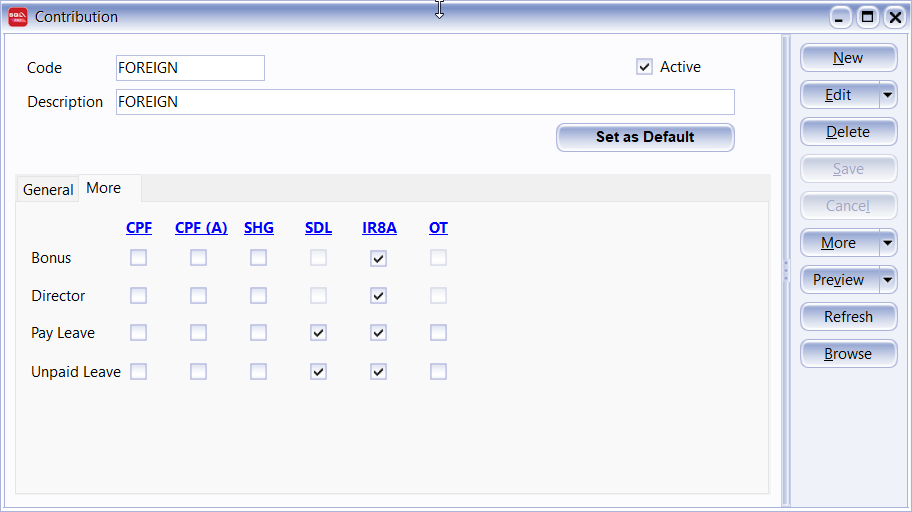 |

### 4.3 Maintain Allowance

- Setting up Maintain Allowance helps you categorize the type of allowance that employees are entitled to.
- This affects the types of contributions required and statutory reporting.
- This is especially useful if you have different types of allowances such as Petrol, Handphone, or Meal Allowance based on different company entitlements.

1. Navigate to **Payroll** > **Maintenance** > **Maintain Allowance**.

    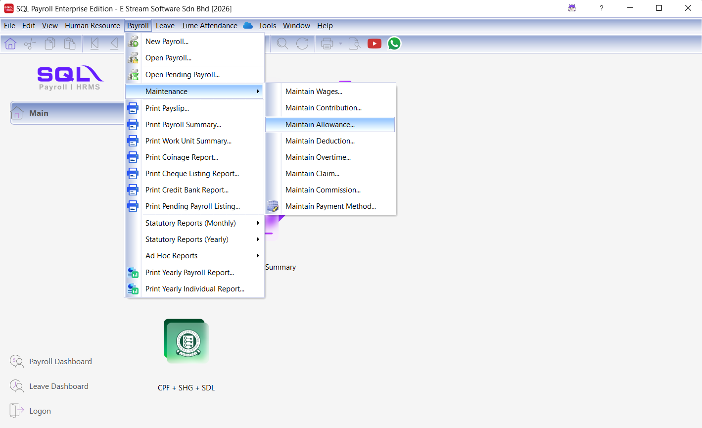

2. Click **New** to create an allowance.

    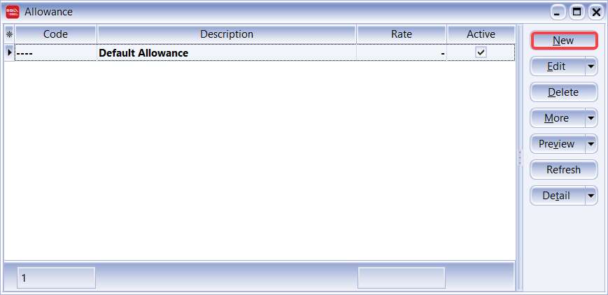

3. Enter the allowance information and select the applicable contribution options.

    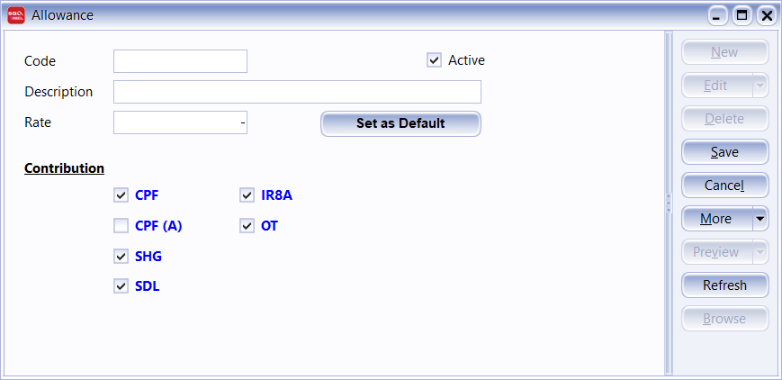

    | Field Name     | Definition                                                                                                   |
    | -------------- | ------------------------------------------------------------------------------------------------------------ |
    | Code           | An Allowance Code (Max 20 Characters)                                                                        |
    | Description    | A Full Description for Allowance (Max 160 Characters)                                                        |
    | Rate           | Rate of allowance payable.                                                                                   |
    | Active         | Uncheck if the selected Allowance code is unavailable                                                        |
    | Set as Default | Click this button to set this Allowance Code as the default                                                  |
    | CPF            | Contribute to Ordinary Wages of Central Provident Fund (CPF)                                                 |
    | CPF (A)        | Contribute to Additional Wages of Central Provident Fund (CPF)                                               |
    | SHG            | Contribution to Self Help Group of employee selected in Employee [Self-Help Group](#316-self-help-group) tab |
    | SDL            | Contribute to Skill Development Levy of employee                                                             |
    | IR8A           | Report to IR8A Form                                                                                          |
    | OT             | Allow the amount to contribute to Overtime (OT)                                                              |

### 4.4 Maintain Deduction

- Setting up Maintain Deduction helps you categorize deductions from employee pay.
- Each deduction type has configurable contribution and statutory reporting options.
- This is useful for deductions such as employee loan repayments or salary advances.

1. Navigate to **Payroll** > **Maintenance** > **Maintain Deduction**.

    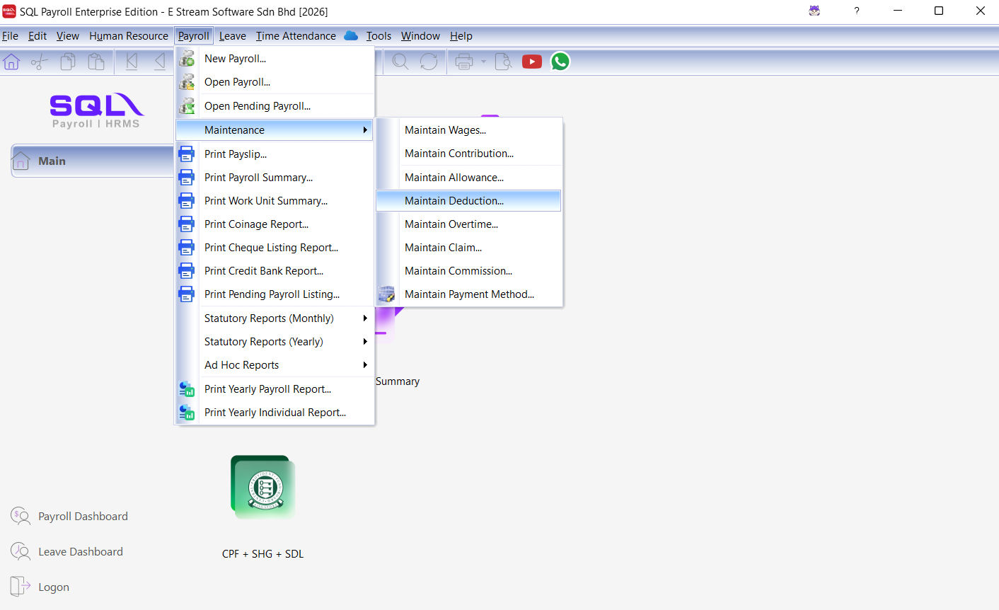

2. Click **New** to create a deduction.

    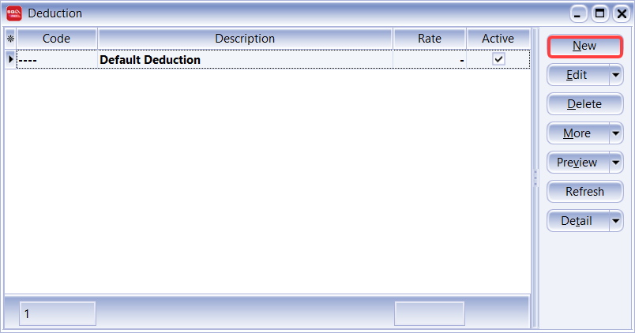

3. Enter the deduction information and select the applicable contribution options.

    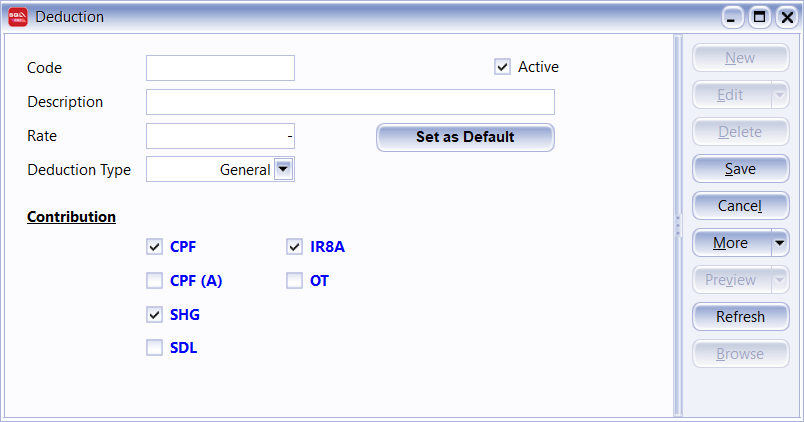

    | Field Name     | Definition                                                                                                   |
    | -------------- | ------------------------------------------------------------------------------------------------------------ |
    | Code           | A Deduction Code (Max 20 Characters)                                                                         |
    | Description    | A Full Description for Deduction (Max 160 Characters)                                                        |
    | Rate           | Rate of deduction.                                                                                           |
    | Deduction Type | Type of deduction.                                                                                           |
    | Active         | Uncheck if the selected Deduction code is unavailable                                                        |
    | Set as Default | Click this button to set this Deduction Code as the default                                                  |
    | CPF            | Contribute to Ordinary Wages of Central Provident Fund (CPF)                                                 |
    | CPF (A)        | Contribute to Additional Wages of Central Provident Fund (CPF)                                               |
    | SHG            | Contribution to Self Help Group of employee selected in Employee [Self-Help Group](#316-self-help-group) tab |
    | SDL            | Contribute to Skill Development Levy of employee                                                             |
    | IR8A           | Report to IR8A Form                                                                                          |
    | OT             | Allow the amount to contribute to Overtime (OT)                                                              |

### 4.5 Maintain Overtime

- Setting up Maintain Overtime helps you categorize the types of overtime offered by the company.
- Overtime types support daily or hourly calculations with a specified rate.
- The contribution and statutory reporting options can be configured for each overtime type.

1. Navigate to **Payroll** > **Maintenance** > **Maintain Overtime**.

    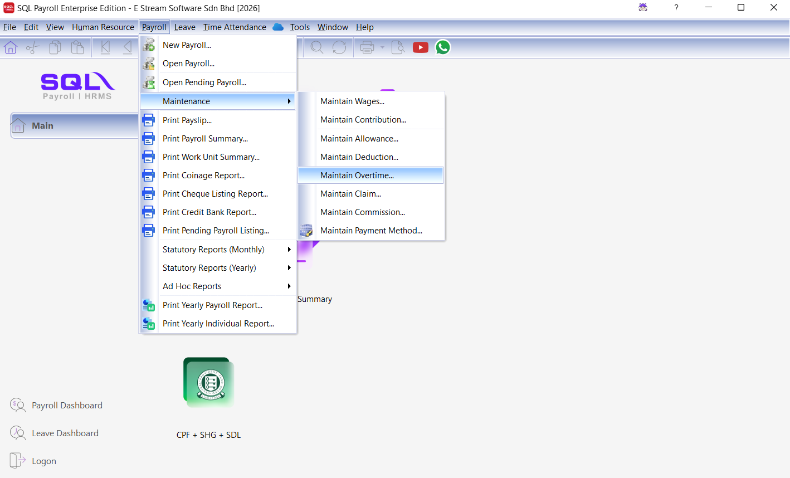

2. Click **New** to create an overtime type.

    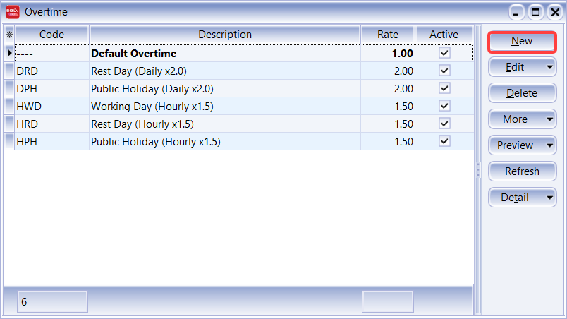

3. Enter the overtime information and select the applicable contribution options.

    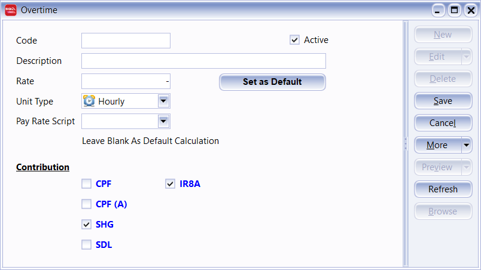

    | Field Name      | Definition                                                                                                   |
    | --------------- | ------------------------------------------------------------------------------------------------------------ |
    | Code            | An Overtime Code (Max 20 Characters)                                                                         |
    | Description     | A Full Description for Overtime (Max 160 Characters)                                                         |
    | Rate            | Overtime rate multiplier (e.g. 1.5 or 2.0).                                                                  |
    | Unit Type       | Select None, Daily, or Hourly for the overtime calculation.                                                  |
    | Pay Rate Script | Select a script for calculating the pay rate. Leave blank to use the default calculation.                    |
    | Active          | Uncheck if the selected Overtime code is unavailable                                                         |
    | Set as Default  | Click this button to set this Overtime Code as the default                                                   |
    | CPF             | Contribute to Ordinary Wages of Central Provident Fund (CPF)                                                 |
    | CPF (A)         | Contribute to Additional Wages of Central Provident Fund (CPF)                                               |
    | SHG             | Contribution to Self Help Group of employee selected in Employee [Self-Help Group](#316-self-help-group) tab |
    | SDL             | Contribute to Skill Development Levy of employee                                                             |
    | IR8A            | Report to IR8A Form                                                                                          |

### 4.6 Maintain Claim

- Setting up Maintain Claim helps you categorize the types of expenses employees can claim, such as travel or communication expenses.
- Claim types support yearly and monthly limits, which may be left unlimited.
- Each claim type supports a unit and rate, with an option to require an attachment.

1. Navigate to **Payroll** > **Maintenance** > **Maintain Claim**.

    

2. Click **New** to create a claim.

    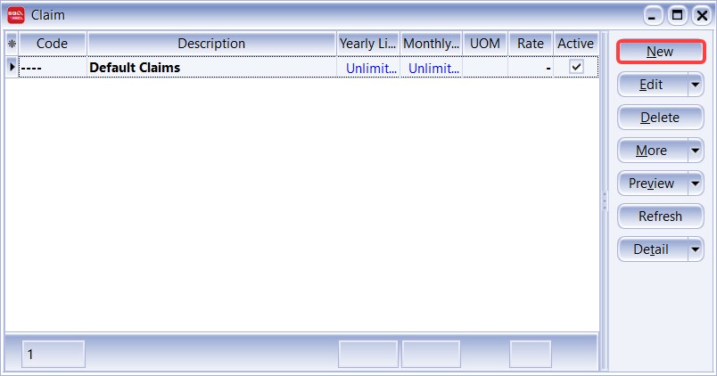

3. Enter the claim information and set the applicable limits.

    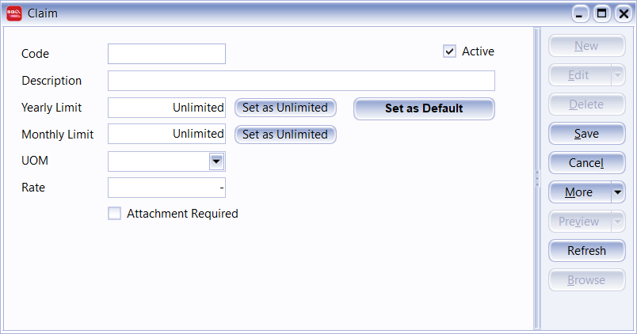

    | Field Name          | Definition                                                                           |
    | ------------------- | ------------------------------------------------------------------------------------ |
    | Code                | A Claim Code (Max 20 Characters)                                                     |
    | Description         | A Full Description for Claim (Max 160 Characters)                                    |
    | Yearly Limit        | Maximum claim amount per year. Click Set as Unlimited if there is no yearly limit.   |
    | Monthly Limit       | Maximum claim amount per month. Click Set as Unlimited if there is no monthly limit. |
    | UOM                 | Unit of measurement for the claim, such as KM.                                       |
    | Rate                | Rate for the claim.                                                                  |
    | Attachment Required | Check if an attachment is required for this claim type.                              |
    | Active              | Uncheck if the selected Claim code is unavailable                                    |
    | Set as Default      | Click this button to set this Claim Code as the default                              |

### 4.7 Maintain Commission

- Setting up Maintain Commission helps you categorize the types of commission paid to employees.
- Each commission type has a configurable rate.
- The contribution and statutory reporting options can be configured for each commission type.

1. Navigate to **Payroll** > **Maintenance** > **Maintain Commission**.

    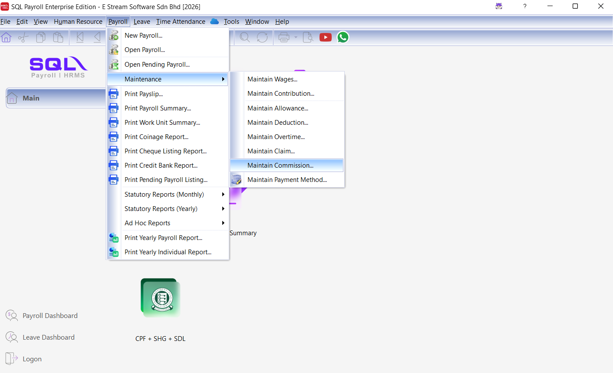

2. Click **New** to create a commission.

    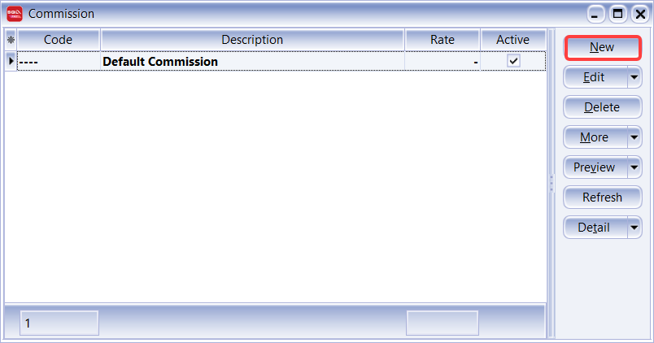

3. Enter the commission information and select the applicable contribution options.

    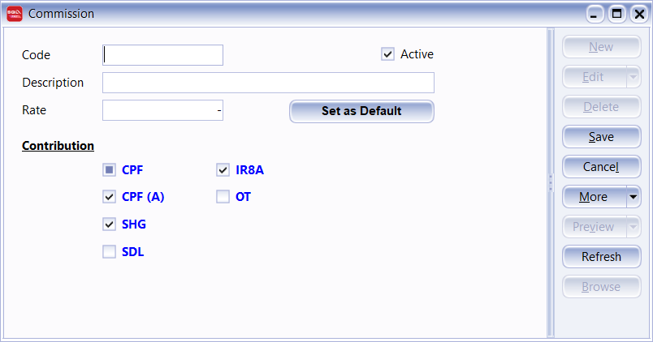

    | Field Name     | Definition                                                                                                   |
    | -------------- | ------------------------------------------------------------------------------------------------------------ |
    | Code           | A Commission Code (Max 20 Characters)                                                                        |
    | Description    | A Full Description for Commission (Max 160 Characters)                                                       |
    | Rate           | Rate of commission payable.                                                                                  |
    | Active         | Uncheck if the selected Commission code is unavailable                                                       |
    | Set as Default | Click this button to set this Commission Code as the default                                                 |
    | CPF            | Contribute to Ordinary Wages of Central Provident Fund (CPF)                                                 |
    | CPF (A)        | Contribute to Additional Wages of Central Provident Fund (CPF)                                               |
    | SHG            | Contribution to Self Help Group of employee selected in Employee [Self-Help Group](#316-self-help-group) tab |
    | SDL            | Contribute to Skill Development Levy of employee                                                             |
    | IR8A           | Report to IR8A Form                                                                                          |
    | OT             | Allow the amount to contribute to Overtime (OT)                                                              |

### 4.8 Maintain Payment Method

- Setting up Maintain Payment Method helps you categorize how employees are paid.
- Payment methods support cash, cheque, and direct transfer, with the relevant bank details.
- An optional rounding script controls net pay rounding.

1. Navigate to **Payroll** > **Maintenance** > **Maintain Payment Method**.

    

2. Click **New** to create a payment method.

    

3. Enter the payment method information.

    

    | Field Name       | Definition                                                       |
    | ---------------- | ---------------------------------------------------------------- |
    | Code             | A Payment Method Code (Max 20 Characters)                        |
    | Description      | A Full Description for Payment Method (Max 160 Characters)       |
    | Bank             | Bank associated with the payment method.                         |
    | Bank Account No. | Bank account number for the payment method.                      |
    | Bank Charge      | Bank charge amount for the payment method.                       |
    | Payment Type     | Select Cash, Cheque, or Direct Transfer.                         |
    | Net Pay          | Select a rounding script for net pay, if applicable.             |
    | Branch           | Bank branch.                                                     |
    | Address          | Address of the bank branch.                                      |
    | Contact Person   | Contact person for the payment method.                           |
    | Ref              | Reference information for the payment method.                    |
    | Phone            | Phone number for the payment method.                             |
    | Fax              | Fax number for the payment method.                               |
    | Active           | Uncheck if the selected Payment Method code is unavailable       |
    | Set as Default   | Click this button to set this Payment Method Code as the default |

## 5 Payroll

### 5.1 Final Process

Used to process monthly salary and final salary.

:::info
If payroll has been created for the month, go to [Open Payroll](#53-open-payroll) for making amendments.
:::

1. Navigate to **Payroll** > **New Payroll**.

    

2. Select **Final**, enter the payroll period and dates, and check the employees to include. Then click **Process**.
    :::tip
    Some companies do not have a month-end payroll cut-off date (e.g., the 26th of the month). You can preset your company's payroll cut-off date using the "..." button.
    :::

    

### 5.2 Ad Hoc Process

Used to process mid-month Ad Hoc Payroll.

1. Select **Ad Hoc** option.

    

2. Select **Process** option.

    1. Bonus / Allowance (To input your amount)

        - All contributions (CPF, SHG) for Fixed Transactions will be 0.
        - Values will be 0 (Zero), and the user needs to manually enter a value for all or selected employees.

        

   2. Monthly Fixed Allowance / Pending Payroll 

        - This option allows the user to control the Contribution (default 100%) for Fixed Transactions.

            

3. Click **Process**.

### 5.3 Open Payroll

1. Navigate to **Payroll** >  **Open Payroll**.

    

2. Double-click the payroll shown for the current month. To open another period, double-click its year, then double-click the payroll process you need.

    

3. Double-click an employee to open the employee's paysheet.

    

### 5.4 Open Pending Payroll

1. Navigate to **Payroll** > **Open Pending Payroll**.

    

2. Double click on the transaction to input. eg. Overtime.

    

3. Insert the overtime info accordingly:
    
    1. Click the ➕ button to add new overtime.

        

    2. Insert the transaction accordingly, such as employee, overtime code, work unit, etc.

        

    3. Once updated. Click **Save**.   

         

    4. Once the update is finished, you may process the month-end and observe the result.   

         

#### View Pending Transactions

- To browse by month, click **Pending YYYY** (YYYY represents current year), then double-click the month.

  

- To filter by transaction type, click **Pending Navigator**, then select the month, year, and transaction type.

  

- To browse by year, click **Show All Pending Payroll**, then double-click the year.

  

### 5.5 Example of Creating Open Pending Payroll

#### 5.5.1 Advance Paid

Process the advance before the employee's Final payroll for the same period.

1. Navigate to **Payroll | Open Pending Payroll**.

    

2. Double-click **Advance Paid**.

    

3. Click **+** and enter the advance details. The example pays employee **001** an advance of **500.00** on **2 November 2026**.

    

    | Field Name  | Definition                                                   |
    | ----------- | ------------------------------------------------------------ |
    | Trans Date  | Date of the advance transaction.                             |
    | Post Date   | Posting date of the advance transaction in payroll.          |
    | Employee    | Employee receiving the advance.                              |
    | Description | Description of the advance, such as November salary advance. |
    | Ref 1       | Reference information for the advance.                       |
    | Ref 2       | Additional reference information for the advance.            |
    | Amount      | Advance amount to pay.                                       |

4. Leave the edited cell and click **Save**, the disk icon on the pending transaction toolbar.

    

5. Navigate to **Payroll | New Payroll**.

    

6. Select **Ad Hoc**. Set the period and **Process Date**, and select the employee receiving the advance.

    

7. Select **Process** Option. 

    1. Click **Monthly Fixed Allowance / Pending Payroll**. 

        

    2. Under **Pending Transaction**, check **Advance Paid** only. Leave the fixed transactions unchecked.

        

8. Click **OK**. Enter **Description 1**, such as **Advance November 2026**. Confirm the employee selection and contribution options, then click **Process**. In the example, **CPF** and **SHG** are unchecked.

    

    | Field Name    | Definition                                                                                                                                                                                  |
    | ------------- | ------------------------------------------------------------------------------------------------------------------------------------------------------------------------------------------- |
    | Process Date  | Date of the advance payroll process.                                                                                                                                                        |
    | Description 1 | Description used to identify the advance payroll in Open Payroll.                                                                                                                           |
    | Employee      | Check the employee receiving this payment.                                                                                                                                                  |
    | CPF           | Include CPF calculation for this Ad Hoc run.                                                                                                                                                |
    | SHG           | Calculate the contribution to the employee's selected [Self-Help Group](#316-self-help-group) in this Ad Hoc run.                                                                           |

9. Double-click employee **001** to open the paysheet. Check **Advance Paid** and **NET PAY**.

    

10. Navigate to **Payroll** > **Open Pending Payroll** again.

    

11. Double-click **Advance Deduct**.

    

12. Check the generated read-only recovery row's employee, amount, and posting date before processing month-end.

    

13. After processing **Final** payroll, open the employee’s paysheet and check **Advance Deduct**, **Gross Deduct**, and **NET PAY**.

    

#### Bonus

1. Navigate to **Payroll** > **Open Pending Payroll**.

    

2. Double-click **Bonus**.

    

3. Click **+**, select the employee, and enter the approved bonus in **Amount**. The example uses employee **001** and an amount of **1,000.00**.

    

    | Field Name  | Definition                                                                 |
    | ----------- | -------------------------------------------------------------------------- |
    | Trans Date  | Date of the bonus transaction.                                             |
    | Post Date   | Posting date of the bonus transaction in payroll.                          |
    | Employee    | Employee receiving the bonus.                                              |
    | Description | Description of the bonus transaction.                                      |
    | Amount      | Approved bonus amount.                                                     |

4. Leave the edited cell and click **Save**, the disk icon on the pending transaction toolbar.

    

5. Navigate to **Payroll** > **New Payroll**.

    

6. Select **Ad Hoc**. Set the period and dates, and select the employee receiving the bonus.

    

7. Select **Process** Option.
    
    1. Select **Monthly Fixed Allowance / Pending Payroll**. 

    

    2. Under **Pending Transaction**, check **Bonus** only. Leave the fixed transactions unchecked.

    

8. Click **OK**. Enter **Description 1**, such as **Bonus November 2026**. Select the contribution options that apply, then click **Process**. In the example, **CPF** and **SHG** are checked.

    

    | Field Name    | Definition                                                                                                                                                                       |
    | ------------- | -------------------------------------------------------------------------------------------------------------------------------------------------------------------------------- |
    | Process Date  | Date of the bonus payroll process.                                                                                                                                               |
    | Description 1 | Description used to identify the bonus payroll in Open Payroll.                                                                                                                  |
    | Employee      | Check the employee receiving this payment.                                                                                                                                       |
    | CPF           | Include CPF calculation for this Ad Hoc run.                                                                                                                                     |
    | SHG           | Calculate the contribution to the employee's selected [Self-Help Group](#316-self-help-group) in this Ad Hoc run.                                                                |

9. Double-click employee **001** to open the paysheet. Check **Bonus**, **CPF**, **SHG**, and **NET PAY**. Click **CPF** to check the contribution breakdown.

    

### 5.6 Generate Payment Voucher / Journal Entry

:::success[note]
This is an **Additional Module** (Payroll Accounting (SQL Payroll)).
:::

This module generates monthly payroll data converted into double entry and posts it into SQL Account.

#### Overview of the Process Flow

#### Configure Payroll Accounting (One-time Setup)

1. Navigate to **Payroll** > **Generate Payment Voucher / Journal Entry...**

2. At Generate Payment Voucher / Journal Entry, click on **Configure Payroll Accounting**.

    

3. Overview of the Configure Payroll Accounting settings screen.

    

#### Step 1: Save GL Account to File (SQL Account)

1. Login to the SQL Account database.

2. Go to **File > Import > (SQL Payroll) Import Payment Voucher / Journal Entry > Save GL Account File**.

    

    

3. Save the SQL Account file to the Desktop.

    

#### Step 2: SQL Account GL Code

1. Click on **Load From File**.

    

2. Select a **SQL Account file (\*.txt)** and click **Open**.

    

3. After the SQL Account GL Code has loaded, the company name and the last saved date and time will be displayed.

    

4. Click the **Remove File** button if you wish to load a new chart of accounts.

#### Step 3: GL Account Mapping

1. After loading the chart of accounts (in Step 2), you can lookup and **map the GL Account code** to wages, allowance, overtime, bonus, etc., accordingly.

    

2. Example of account mapping:

    |Payroll                | Account                              | Acc Type  |
    |-----------------------|--------------------------------------|-----------|
    |Wages                  | Salary                               | P&L       |
    |Allowance              | Allowance, eg. meal, petrol, parking | P&L       |
    |Overtimes              | Overtimes                            | P&L       |
    |Commission             | Sales Commission                     | P&L       |
    |Claim                  | Petrol, Toll, other expenses claims  | P&L       |
    |Paid Leave             | Salary                               | P&L       |
    |Director Fees          | Director Fees                        | P&L       |
    |Bonus                  | Bonus                                | P&L       |
    |Advance Paid           | Salary                               | P&L       |
    |Loan                   | Loan                                 | B/S       |
    |Deduction              | Salary                               | P&L       |
    |Unpaid Leave           | Salary                               | P&L       |
    |Advance Deduct         | Salary                               | P&L       |
    |Employee CPF (Accrual) | CPF Accrual                          | P&L       |
    |Employer CPF (JE)      | Employer CPF                         | P&L       |
    |SHG                    | SHG Accrual                          | B/S       |
    |SDL (Accrual)          | SDL Accrual                          | B/S       |
    |SDL (JE)               | SDL                                  | P&L       |
    |Payment Method         | Bank Account                         | B/S       |

#### Step 4: Posting Method

1. Generate posting entry by **Payment Voucher** or by **Journal Entry**.

2. Group by **Employee** (available in payment voucher), **Branch, Department, HR Group, or Category**.

3. Check **With Project Code** to post the entry with a project code.

4. **OPTIONAL:** Generate Journal Entry for Employer EPF, SOCSO Accrual **(unchecked by default)**. Some companies may charge the Employer EPF and SOCSO accrual in the next month.

    

#### Generate Payment Voucher / Journal Entry (Export)

To generate the Payment Voucher or Journal Entry from SQL Payroll, click on **Generate**.

#### Import Payment Voucher / Journal Entry (Import)

1. Login to the SQL Account database.

2. Go to **File** > **Import** > **(SQL Payroll) Import Payment Voucher / Journal Entry...**

3. Click on **Select File** and choose the Payment Voucher/Journal Entry (payroll data) generated from SQL Payroll.

    

4. Click on **Execute**.

    

## 6 Leave

The Leave module is used to monitor employee leave, manage the company calendar, and print attendance reports. It consists of four sections:

1. **Maintenance**
2. **Leave Entitlement Processor**
3. **Leave Application**
4. **Reports**

### 6.1 Leave Application

- **Records leave applied for by each employee. You can input any type of leave defined in Maintain Leave Type.**
- **You can assign a calendar to individual employees in Maintain Employee. This will load the employee's leave application.**
- It monitors leave applications based on the up-to-date leave entitlement.

    For example:

    1. **Annual Leave Entitlement = 12 days**
    2. **Average Annual Leave Entitlement = 1 day per month**
    3. **Annual Leave applied for a month:**
        - **January = 0 days**
        - **February = 1 day**
        - **March = 0 days**

    In this scenario, the total annual leave entitled up to April is 4 days (including April).

    This means the remaining annual leave is (4 – 1) = 3 days.

    If the employee applies for 4 days of leave in April, the system will prompt the warning: “You’ve taken 5.0 days of Annual Leave, but Annual Leave limit for April is 4.0 days.”

    You can then choose to Allow, Not Allow, or treat it as Unpaid Leave.

1. Navigate to **Leave** > **Open Leave**.

    

2. Click **New Leave Application**.

    

3. Select the **Employee** and **Year**, then click **Apply Leave**.

    

4. Click the **+** button. A row will appear where you can select the date, leave type, and number of days applied.

    

5. If the employee applies for half-day leave or hourly leave, use the **Day As Time** column (1 working day = 8 working hours).

    

6. Enter the duration (e.g., 3 hours). The system will automatically calculate the number of days (e.g., 0.38 days).

    

### 6.2 Leave Entitlement Processor

**It processes annual leave entitlement for each employee based on their leave group.**

1. The leave entitlement process is typically performed once a year. Navigate to **Leave** > **Leave Entitlement Processor**.

    

2. Select the Transaction Posting Year (e.g., 2026) and click **Process**.

    

3. A table will display the leave entitlement for each employee for the selected year.

    

4. You can edit the number of days if necessary. Click **Save** when finished.

    

### 6.3 Maintain Public Holiday Calendar

1. Navigate to **Leave** > **Maintain Public Holiday Calendar...**. 

    

2. Select a calendar or create a **New** one.

    

3. Set public holidays. You can import the default Singapore public holiday calendar or set it manually.

- Option 1: Import the default Singapore Public Holiday Calendar 

    1. Click the **Global** icon.

        

    2. Click **OK**.
        :::info
        You can check or uncheck specific dates.
        :::
        
        

- Option 2: Manual set holiday

    1. Click the **'P'** button and select a date from the calendar.

        

4. Click **Save**.

### 6.4 Maintain Leave Type

**Maintain Leave Type** defines the types of leave, such as annual leave, medical leave, maternity leave, unpaid leave, etc. You can also configure settings such as:

- Is Entitled
- Is Unpaid
- Brought Forward

:::info
Before assigning a leave group to an employee, ensure that Leave Types and Leave Groups are maintained. **Leave Type** defines the nature of the leave, while **Leave Group** groups employees according to their leave entitlement.
:::

1. Navigate to **Leave** > **Maintain Leave Type**.

    

2. Click the **New** button in the top right corner to create a new leave type.

    

3. Assign a code for the leave type.

    :::tip Example
    `ML` for Maternity Leave:

    - Check the relevant pay entitlement.
    - Click **Save**.
      :::

    

4. The new leave type is created.

    

#### 6.4.1 Brought Forward Leave

Ensure **Brought Forward (BF)** is checked in **Maintain Leave Type**.

1. Navigate to **Leave** > **Maintain Leave Type**

    

    

    Ensure there is a calculation for the amount of leave brought forward in **Maintain Leave Group**.

2. Navigate to **Leave** > **Maintain Leave Group**.

    

3. Make sure the BF column is ticked.

    

4. Click **Edit**

    

5. Click the **tree-dot icon** to set the Leave B/F rule

    

    At here, you can choose to use:
    - Standard Calculation, or
    - Custom Calculation (script customization)

    

    

    
Standard vs Custom Calculation

    **Standard Calculation**

    An easy-to-use interface that allows users to configure BF Leave, including setting a fixed
    maximum number of carry-forward days and defining a special expiry date by which the BF
    leave must be utilized.

    1. Tick this option and set the maximum days allowed carry forward to the next year. 
        
        > Tips: If you do not have the BF limit, you may ignore this step.

    2. Tick the option to set the expiry date, and select the Month and Day
        
        BF Leave balance will be considered forfeit at the next day of the expiry date.
        For this sample : Leave Expiry Date - 31/03, Leave Forfeit - 01/04
        > Tips: If you do not have Bring Forward leave with an expiry date, you may ignore this step.

    **Custom Calculation**

    Extensive BF leave calculation logic is implemented through scripting and is generally
    developed by a programmer.

    1. Select this calculation method, and click the dropdown icon to load in the script
        

    

### 6.5 Maintain Leave Group

:::info Features

- Allows you to customize leave policies for different employee levels.
- You can customize scripts (under **Tools** > **Maintain Script**) and apply them to the leave group.

:::

1. Navigate to **Leave** > **Maintain Leave Group**.

    

2. Click the **New** button in the top right corner.

    

3. Assign a code for the new leave group.

    :::tip Example
    `FW` for Foreign Worker.

    Click the **+** button to select the entitled leave types for this group.
    :::

    

5. Click the **...** button beside the **Entitle** column to customize the calculation.

    

6. For example, if your company uses the following calculation:

    | Year of Service (Years) | Day of Leave Entitled (Days) |
    | ----------------------- | ---------------------------- |
    | 1 to 2                  | 8                            |
    | 3 to 5                  | 12                           |
    | >5                      | 14                           |

    Enter the table as follows:

    | Year From | Year To | Days |
    | --------- | ------- | ---- |
    | 1         | 2       | 8    |
    | 3         | 5       | 12   |
    | 6         | 99      | 14   |

    

7. Click **OK** to finish.

#### Employee Leave Group Assignment

1. Navigate to **Human Resource** > **Maintain Employee**.

    

2. Select the relevant employee, then click **Edit**.

    

3. Click the **Grouping** tab. You will see **Leave Group** in the last panel.

    

4. Assign the relevant leave group.

    :::tip Example
    Foreign Worker (FW).
    Click **Save**.
    :::

    
    

### 6.6 Leave Report

| Report                                                      | Description                                                                                                |
| ----------------------------------------------------------- | -----------------------------------------------------------------------------------------------------------|
| [Leave Application Report](#print-leave-application-report) | Generates detailed leave taken by each employee for a year.                                                |
| [Attendance Report](#print-attendance-report)               | Generates attendance performance in percentage.                                                            |
| [Leave Balance Report](#print-leave-balance-report)         | Analyzes the number of days taken for annual leave, medical leave, etc.                                    |
| [Yearly Leave Report](#print-yearly-leave-report)           | Generates a 12-month summary of total leave taken for each leave type (e.g., annual leave, unpaid leave).  |

#### Print Leave Application Report

#### Print Attendance Report

#### Print Leave Balance Report

#### Print Yearly Leave Report

