## 1 SQL Payroll Modules

:::info
SQL Payroll software is built from ground up around Payroll Process. You can easily process and print from one to hundreds of employee's pay slip with just a few mouse click. What's more is that you can virtually keep unlimited payroll history and have your data safe and sound with strong security and data protection.
:::

SQL Payroll consists of 3 main modules:

1. Human Resource
2. Payroll
3. Leave

## 2 Getting Started SQL Payroll System

### 2.1 Setting up Company Profile

1. **File | Company Profile**

    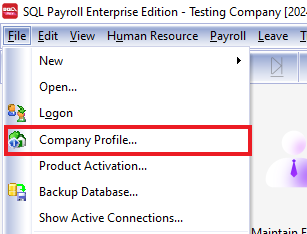

2. Complete the **General** Section.

    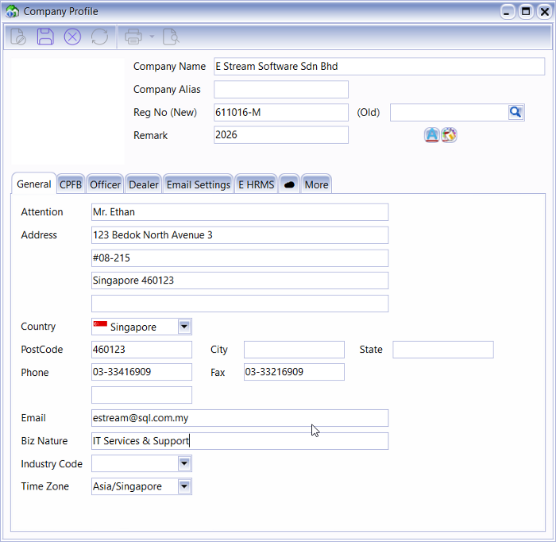

3. Complete the **CPFB** Section.

    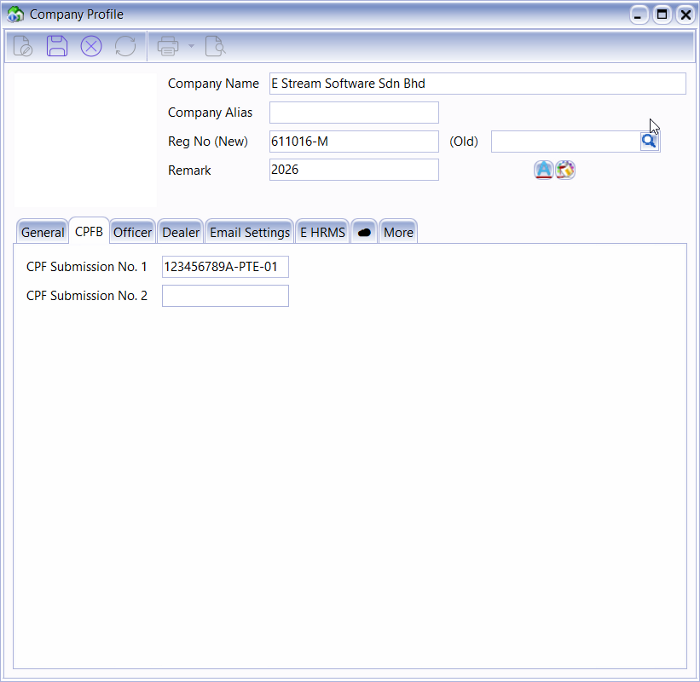

4. Complete the **Officer** Section.

    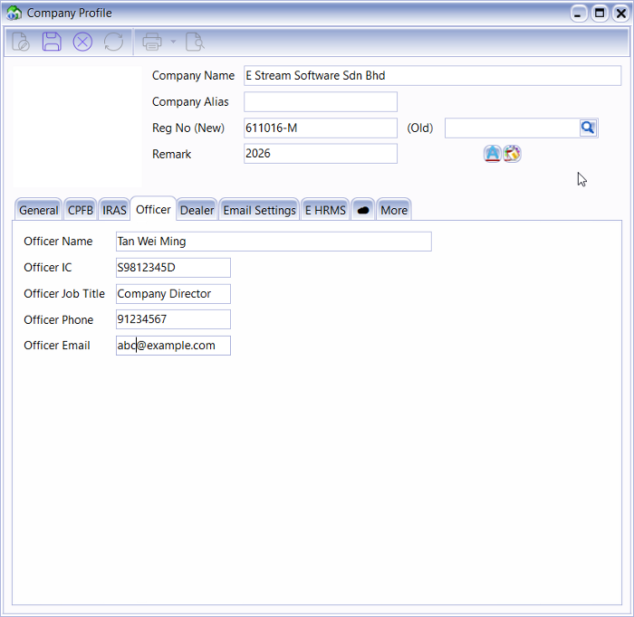
    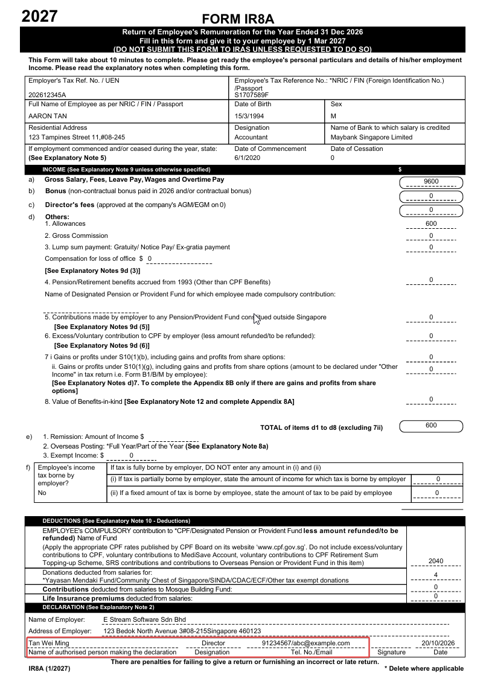

## 3 Human Resource

### 3.1 Maintain Employee

1. Navigate to the Maintain Employee panel.

    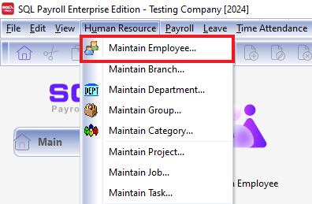

   **OR Click on "Maintain Employee" on the home page.**

    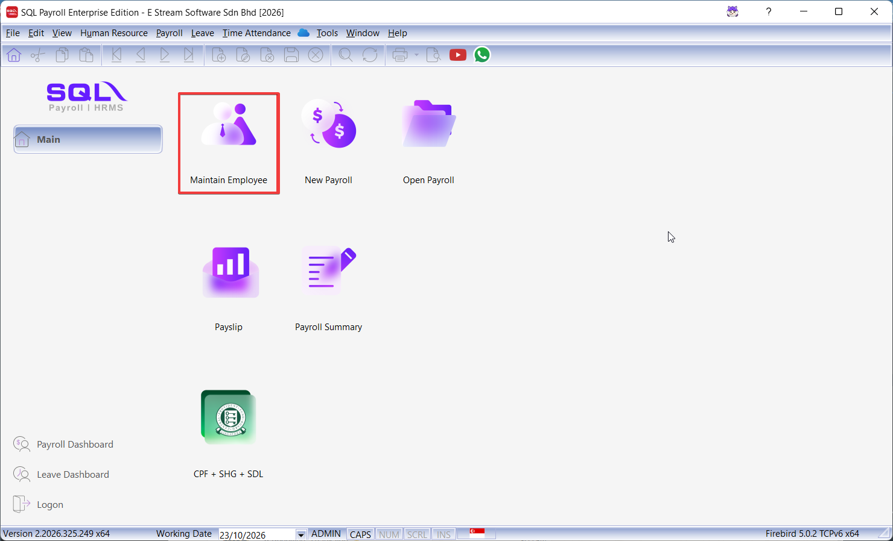

2. Click New to create a new employee.

    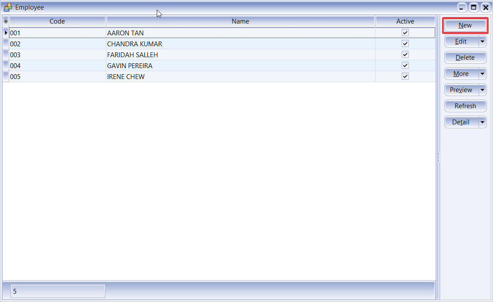

#### 3.1.1 Personal

This tab is used to store employee personal info. 

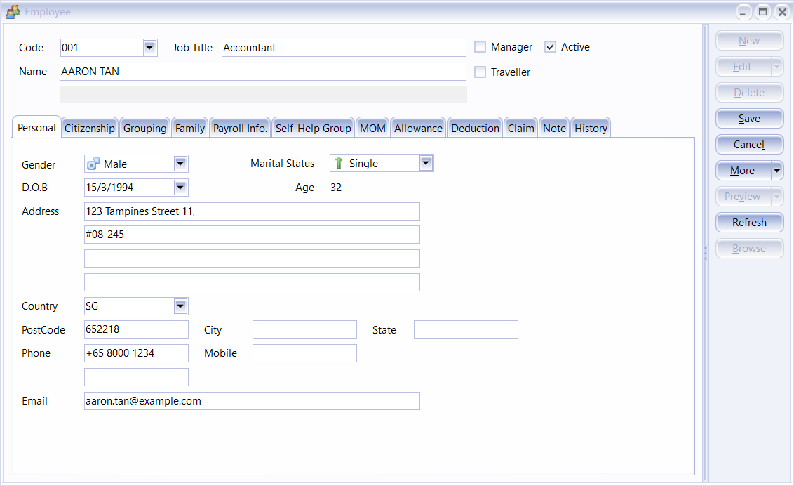

| Field Name        | Definition                                                                                     |
| ------------------| -----------------------------------------------------------------------------------------------|
| Code              | Employee Code                                                                                  |
| Job Title         | Employee Job Title                                                                             |
| Name              | Full Employee Name                                                                             |
| Active            | Unchecked if the selected employee is resigned.                                                |
| Gender            | The Employee Sex                                                                               |
| Marital Status    | The Employee Marriage Status                                                                   |
| D.O.B             | The Employee Date of Birth                                                                     |
| Address           | Employee Correspondence Address                                                                |
| Country           | Country of the Employee Correspondence Address                                                 |
| PostCode          | Postcode of the Employee Correspondence Address                                                |
| City              | City of the Employee Correspondence Address                                                    |
| State             | State of the Employee Correspondence Address                                                   |
| Phone             | Employee Correspondence Phone Number                                                           |
| Mobile            | Employee Handphone Number                                                                      |
| Email             | Employee E-Mail Address                                                                        |

#### 3.1.2 Citizenship

This tab is used to store employee citizenship info. 

    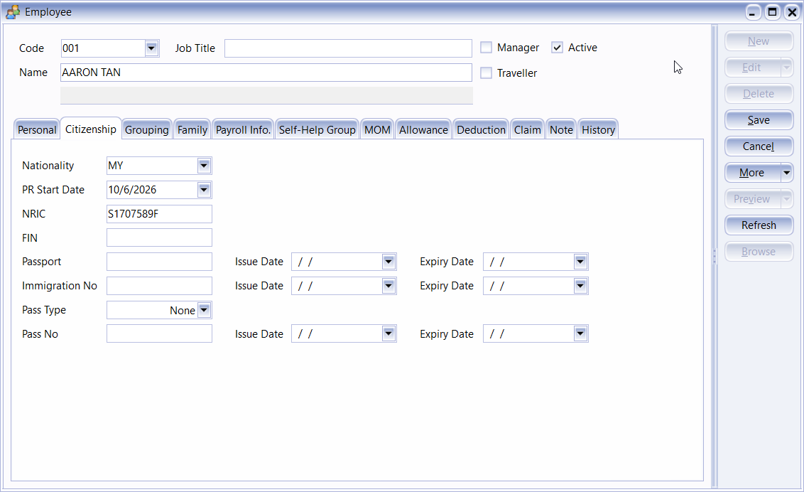

| Field Name              | Definition                                                                                                                 |
| ------------------------| ---------------------------------------------------------------------------------------------------------------------------|
| Nationality             | Employee Nationality                                                                                                       |
| PR Start Date           | Date of Employee granted Permanent Resident status in Singapore                                                            |
| NRIC                    | Employee NRIC                                                                                                              |
| FIN                     | Foreign Identification Number for Foreign Employee                                                                         |
| Passport                | Employee Passport Number                                                                                                   |
| Passport Issue Date     | Employee Passport Issue Date                                                                                               |
| Passport Expiry Date    | Employee Passport Expiry Date                                                                                              |
| Immigration No          | Employee Immigration Number                                                                                                |
| Immigration Issue Date  | Employee Immigration Issue Date                                                                                            |
| Immigration Expiry Date | Employee Immigration Expiry Date                                                                                           |
| Pass Type               | Select Foreign Employee Work Pass Type  1. None 2. Employment Pass  3. S Pass  4. Work Permit 5. Other |                                                                 
| Pass No                 | Employee Work Pass Number                                                                                                  |
| Pass Issue Date         | Employee Work Pass Issue Date                                                                                              |
| Pass Expiry Date        | Employee Work Pass Expiry Date                                                                                             |

#### 3.1.3 Grouping

This tab is used for report grouping for the selected employee. It can be organized by:

    - [Branch](#32-maintain-branch)
    - [HR Group](#34-maintain-group)
    - [Department](#33-maintain-department)
    - [Category](#35-maintain-category)
    - [Project](#36-maintain-project)
    - [Job](#37-maintain-job)
    - [Task](#38-maintain-task)
    - [Race](#39-maintain-race)

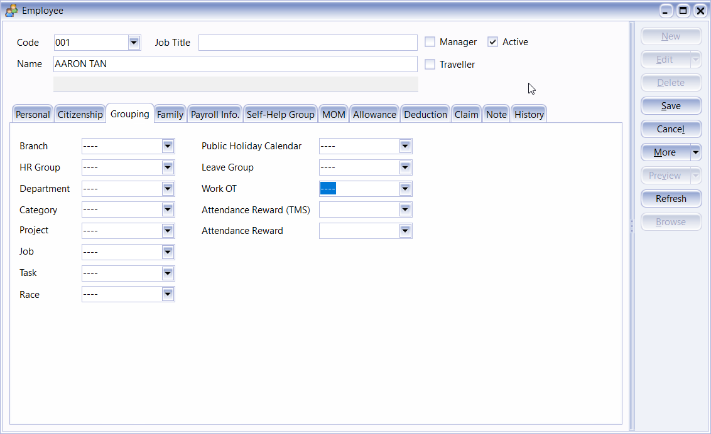

#### 3.1.4 Family

This tab is used to store spouse/family information. It is useful for emergency contact purposes.

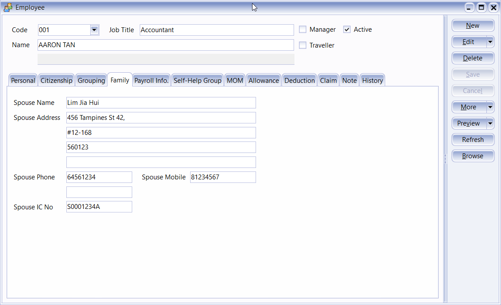

| Field Name        | Definition                                                                                     |
| ------------------| -----------------------------------------------------------------------------------------------|
| Spouse Name       | Employee Code                                                                                  |
| Spouse Address    | Employee Job Title                                                                             |
| Spouse Phone      | Full Employee Name                                                                             |
| Spouse Mobile     | Unchecked if the selected employee is resigned.                                                |
| Spouse IC No      | The Employee Sex                                                                               |
| Marital Status    | The Employee Marriage Status                                                                   |
| D.O.B             | The Employee Date of Birth                                                                     |
| Address           | Employee Correspondence Address                                                                |
| Country           | Country of the Employee Correspondence Address                                                 |
| PostCode          | Postcode of the Employee Correspondence Address                                                |

#### 3.1.5 Payroll Info

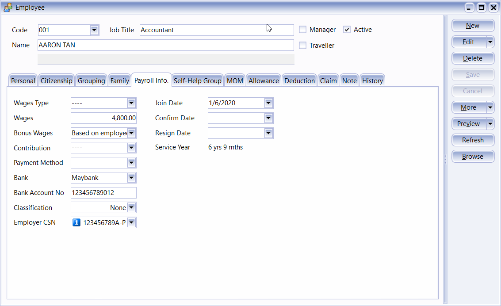

| Field Name        | Definition                                                                                     |
| ------------------| -----------------------------------------------------------------------------------------------|
| Wages Type        | Employee [Wages](#41-maintain-wages) Category Type                                             |
| Wages             | Employee wages amount                                                                          |
| Contribution      | Employee [Contribution](#42-maintain-contribution) Type                                        |
| Payment Method    | Employee [Payment Method](#48-maintain-payment-method)                                         |
| Bank              | Employee Bank                                                                                  |
| Bank Account No   | Employee Bank Account Number                                                                   |
| Classification    | Choose Employee Job Classification  1. None  2. Non-workman  3. Workman            |
| Employer CSN      | Employer CSN under which the employee’s CPF contributions are submitted.                       |
| Join Date         | Employee Join Company Date                                                                     |
| Confirm Date      | Employee Confirmation Date                                                                     |
| Resign Date       | Employee Resign Date                                                                           |

#### 3.1.6 Self-Help Group

This tab is used to select the Self-Help Group applicable to the employee for contribution purpose.

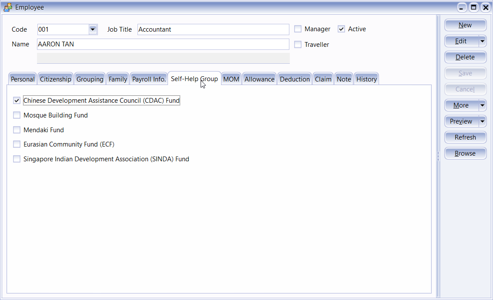

#### 3.1.7 MOM

This tab is used to store the employee info required for submission to the Ministry of Manpower’s Occupational Employment Dataset (OED).

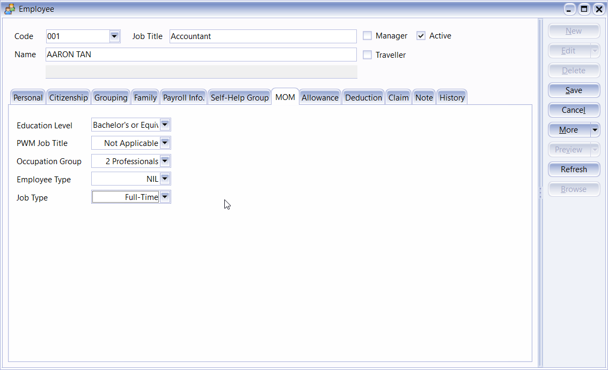

| Field Name        | Definition                                                                                     |
| ------------------| -----------------------------------------------------------------------------------------------|
| Education Level   | Select the employee highest education level                                                    |
| PWM Job Title     | Select the Progressive Wage Model job title applicable to the employee                         |
| Occupation Group  | Select the Occupation Group applicable to the employee                                         |
| Employee Type     | Select the employee type applicable to the employee                                            |
| Job Type          | Select the job type applicable to the employee (eg. Full-time, Part-Time)                      |

#### 3.1.8 Allowance

Use this tab to enter the Fixed Allowance entitled for each month for the selected employee.

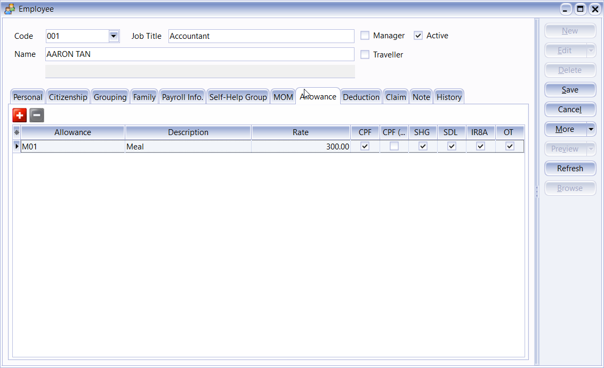

#### 3.1.9 Deduction

Use this tab to enter the Fixed Deduction entitled for each month for the selected employee.

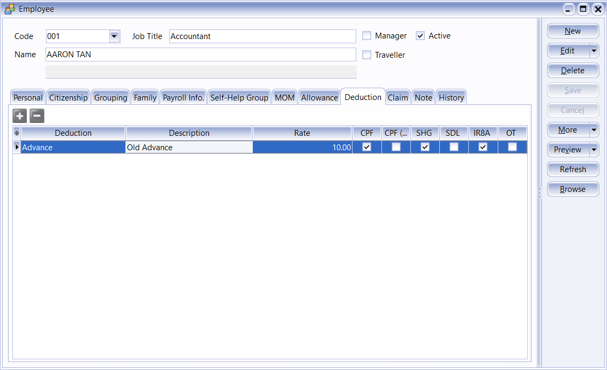

#### 3.1.10 Claim 

Use this tab to enter the Claim available to the employee.

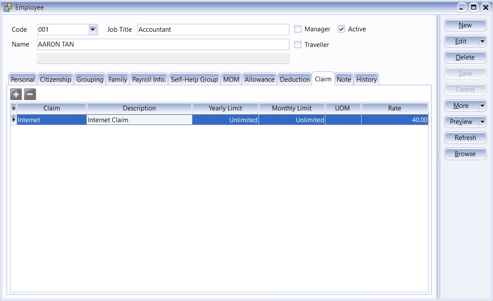 

#### 3.1.11 Note

Use this tab to upload a photo and other information for the selected employee.

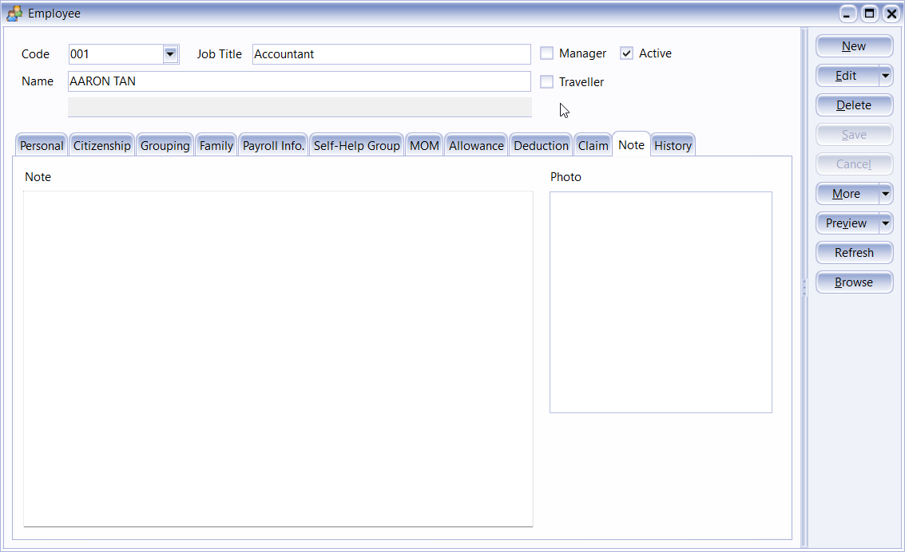 

#### 3.1.12 History

Use this tab to upload a photo and other information for the selected employee.

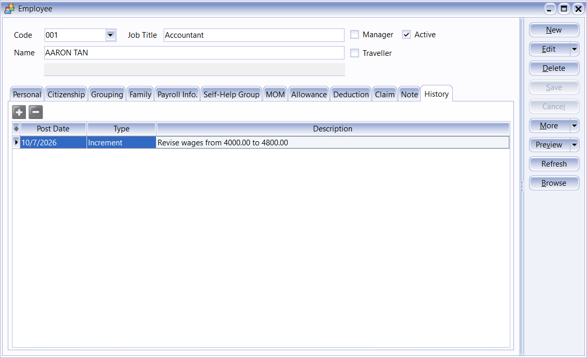 

### 3.2 Maintain Branch

This is useful for companies with multiple branches where the salary is paid from HQ.

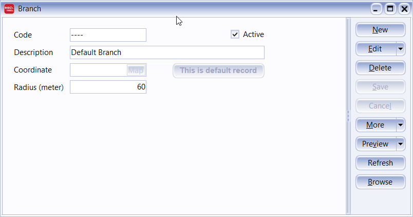

| Field Name        | Definition                                                                                                    |
| ------------------| --------------------------------------------------------------------------------------------------------------|
| Code              | A Branch Code (Max 20 Characters)                                                                             |
| Description       | A Full Description for Branch (Max 160 Characters)                                                            |
| Active            | Uncheck if the selected Branch code is unavailable                                                            |
| Set as Default    | Click this button to automatically assign this Branch Code when creating a new employee at Maintain Employee  |
| Coordinate        | Coordinate of Branch                                                                                          |
| Radius            | Radius of Branch                                                                                              |

### 3.3 Maintain Department

A division of an organization, such as Accounts, Marketing, etc.

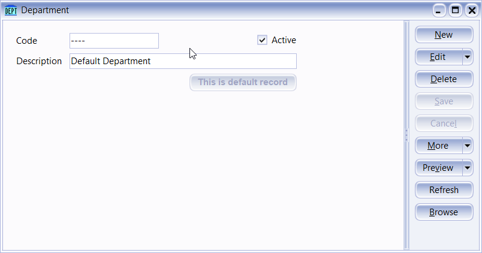

| Field Name        | Definition                                                                                                        |
| ------------------| ------------------------------------------------------------------------------------------------------------------|
| Code              | A Department Code (Max 20 Characters)                                                                             |
| Description       | A Full Description for Department (Max 160 Characters)                                                            |
| Active            | Uncheck if the selected Department code is unavailable                                                            |
| Set as Default    | Click this button to automatically assign this Department Code when creating a new employee at Maintain Employee  |

### 3.4 Maintain Group

Another method for grouping employees in reports.

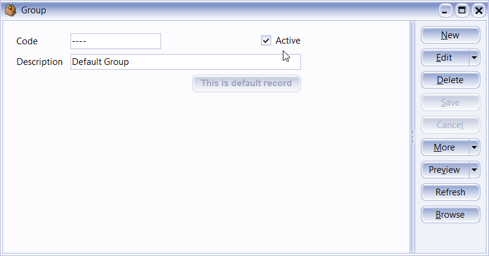

| Field Name        | Definition                                                                                                   |
| ------------------| -------------------------------------------------------------------------------------------------------------|
| Code              | A Group Code (Max 20 Characters)                                                                             |
| Description       | A Full Description for Group (Max 160 Characters)                                                            |
| Active            | Uncheck if the selected Group code is unavailable                                                            |
| Set as Default    | Click this button to automatically assign this Group Code when creating a new employee at Maintain Employee  |

### 3.5 Maintain Category

Divide employees by class or division.

| Field Name        | Definition                                                                                                      |
| ------------------| ----------------------------------------------------------------------------------------------------------------|
| Code              | A Category Code (Max 20 Characters)                                                                             |
| Description       | A Full Description for Category (Max 160 Characters)                                                            |
| Active            | Uncheck if the selected Category code is unavailable                                                            |
| Set as Default    | Click this button to automatically assign this Category Code when creating a new employee at Maintain Employee  |

### 3.6 Maintain Project

Group employees by the project they are working on.

| Field Name        | Definition                                                                                                     |
| ------------------| ---------------------------------------------------------------------------------------------------------------|
| Code              | A Project Code (Max 20 Characters)                                                                             |
| Description       | A Full Description for Project (Max 160 Characters)                                                            |
| Active            | Uncheck if the selected Project code is unavailable                                                            |
| Set as Default    | Click this button to automatically assign this Project Code when creating a new employee at Maintain Employee  |

### 3.7 Maintain Job

Group employees by job type for reporting.

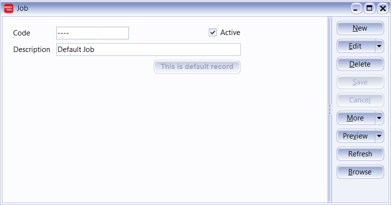

| Field Name        | Definition                                                                                                 |
| ------------------| -----------------------------------------------------------------------------------------------------------|
| Code              | A Job Code (Max 20 Characters)                                                                             |
| Description       | A Full Description for Job (Max 160 Characters)                                                            |
| Active            | Uncheck if the selected Job code is unavailable                                                            |
| Set as Default    | Click this button to automatically assign this Job Code when creating a new employee at Maintain Employee  |

### 3.8 Maintain Task

Divide employees by specific tasks.

| Field Name        | Definition                                                                                                  |
| ------------------| ------------------------------------------------------------------------------------------------------------|
| Code              | A Task Code (Max 20 Characters)                                                                             |
| Description       | A Full Description for Task (Max 160 Characters)                                                            |
| Active            | Uncheck if the selected Task code is unavailable                                                            |
| Set as Default    | Click this button to automatically assign this Task Code when creating a new employee at Maintain Employee  |

### 3.9 Maintain Race

Group employees by race for reporting.

| Field Name        | Definition                                                                                                  |
| ------------------| ------------------------------------------------------------------------------------------------------------|
| Code              | A Race Code (Max 20 Characters)                                                                             |
| Description       | A Full Description for Race (Max 160 Characters)                                                            |
| Active            | Uncheck if the selected Race code is unavailable                                                            |
| Set as Default    | Click this button to automatically assign this Race Code when creating a new employee at Maintain Employee  |

### 3.10 Maintain History Type

Allows users to group changes made in Maintain Employee.

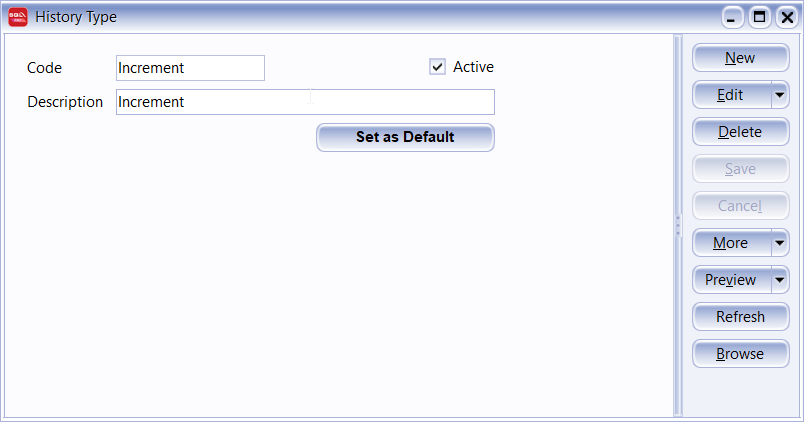

| Field Name        | Definition                                                                                                          |
| ------------------| --------------------------------------------------------------------------------------------------------------------|
| Code              | A History Type Code (Max 20 Characters)                                                                             |
| Description       | A Full Description for History Type (Max 160 Characters)                                                            |
| Active            | Uncheck if the selected History Type code is unavailable                                                            |
| Set as Default    | Click this button to automatically assign this History Type Code when creating a new employee at Maintain Employee  |

### 3.11 Maintain Announcement

Used to create, manage, and distribute company-wide or employee-specific announcements within the payroll and HR system, allowing users to share information, updates, or important reminders with their team.

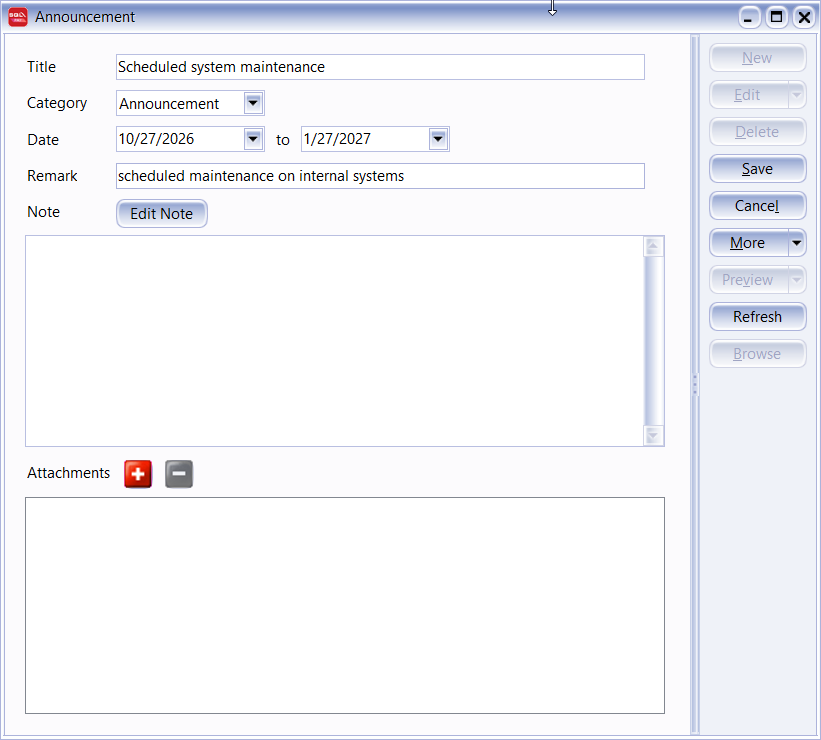

| Field Name        | Definition                                                                                                          |
| ------------------| --------------------------------------------------------------------------------------------------------------------|
| Title             | The title or subject of the announcement                                                                            |
| Date From         | The start date when the announcement becomes active                                                                 |
| Date To           | The end date when the announcement expires or becomes inactive.                                                     |
| Category          | The classification or type of announcement (e.g., General, System Update, Event).                                   |
| Remark            | Additional notes or comments related to the announcement.                                                           |

## 4 Payroll

### 4.1 Maintain Wages

- Setting up Maintain Wages helps you categorize the type of wages an employee receives.
- This affects the types of contributions required and statutory reporting.
- This is especially useful if you have different types of workers such as permanent workers, contract workers, foreign workers, etc.

1. Navigate to **Payroll** > **Maintenance** > **Maintain Wages**

    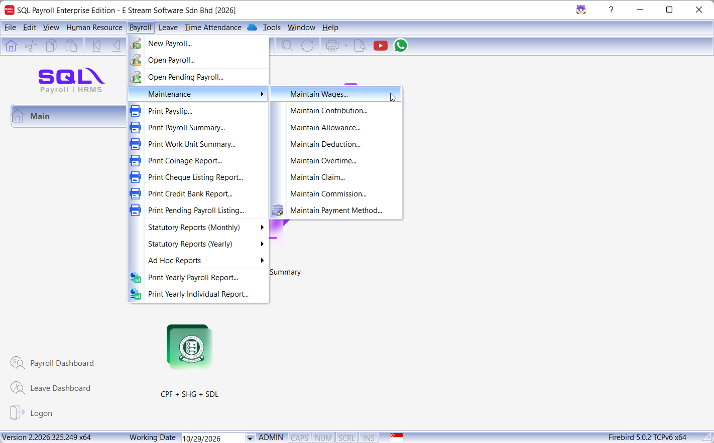

2. Click **New** to create new wages type.

    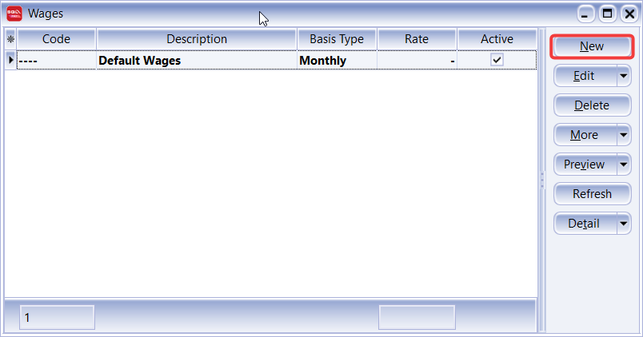

3. Enter the information and check the required contribution.

    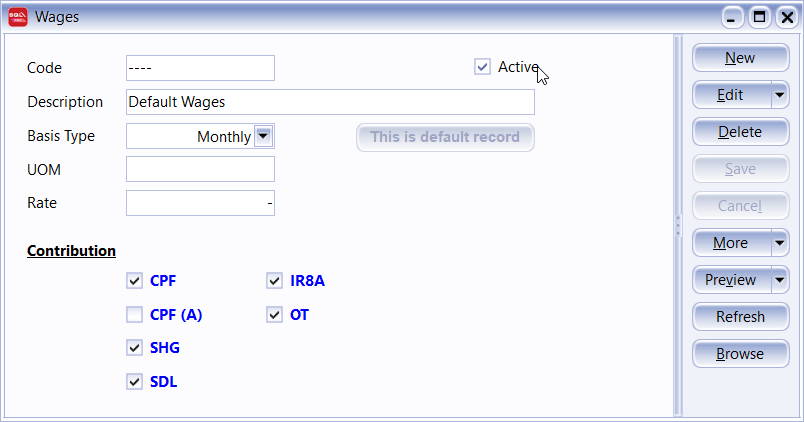

    | Field Name        | Definition                                                                                                                              |
    | ------------------| ----------------------------------------------------------------------------------------------------------------------------------------|
    | Code              | A Wage Code (Max 20 Characters)                                                                                                         |
    | Description       | A Full Description for Wage Type (Max 160 Characters)                                                                                   |
    | Basis Type        | Basis for calculation of employee basic wage. (eg. Monthly, Daily)                                                                      |
    | UOM               | Serve no purpose, for remark only.                                                                                                      |
    | Rate              | Rate of wage payable.                                                                                                                   |
    | Active            | Uncheck if the selected Wages Type code is unavailable                                                                                  |
    | Set as Default    | Click this button to automatically assign this Wage Type Code when creating a new employee at [Maintain Employee](#31-maintain-employee)|
    | CPF               | Contribution to Ordinary Wages of Central Provident Fund (CPF)                                                                          |
    | CPF (A)           | Contribution to Additional Wages of Central Provident Fund (CPF)                                                                        |
    | SHG               | Contribution to Self Help Group of employee selected in Employee [Self-Help Group](#316-self-help-group) tab                            |
    | SDL               | Contribution to Skill Development Levy of employee                                                                                      |
    | IR8A              | Report the wages of employee selected with this wage type in IR8A Form                                                                  |
    | OT                | Allow the amount to contribute to Overtime (OT)                                                                                         |

#### 4.1.1 Common Wages Setup

    | Citizen and Permanent Resident Workers                 | Foreign Workers                                        |
    |--------------------------------------------------------|--------------------------------------------------------|
    | 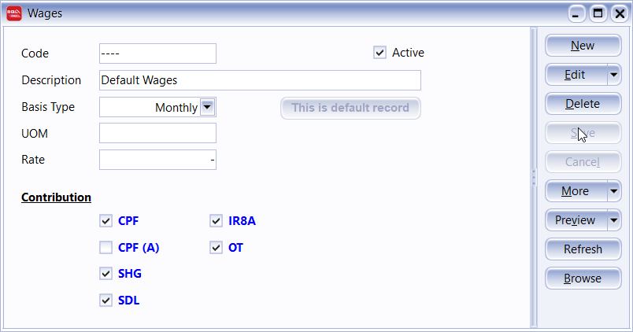 | 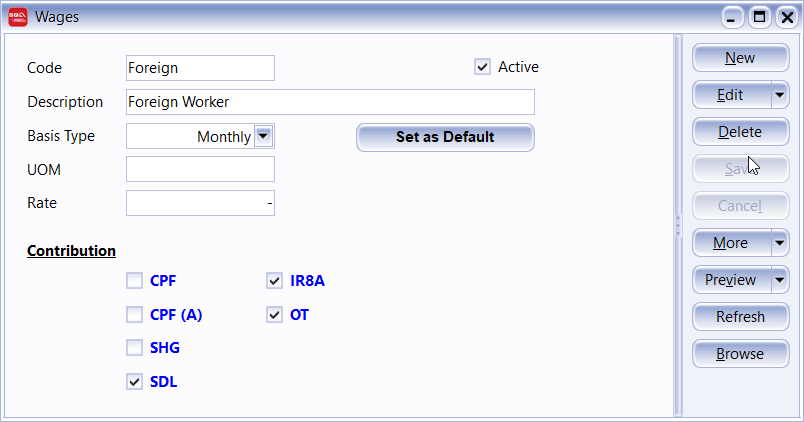 |

### 4.2 Maintain Contribution

:::info
Learn how to set the Permanent Resident CPF rate and OT calculation following this guide.
:::

- Setting up Maintain Contribution helps you categorize the type of contribution an employee receives.
- This affects the types of contributions required.

1. Navigate to **Payroll** > **Maintenance** > **Maintain Contribution**

    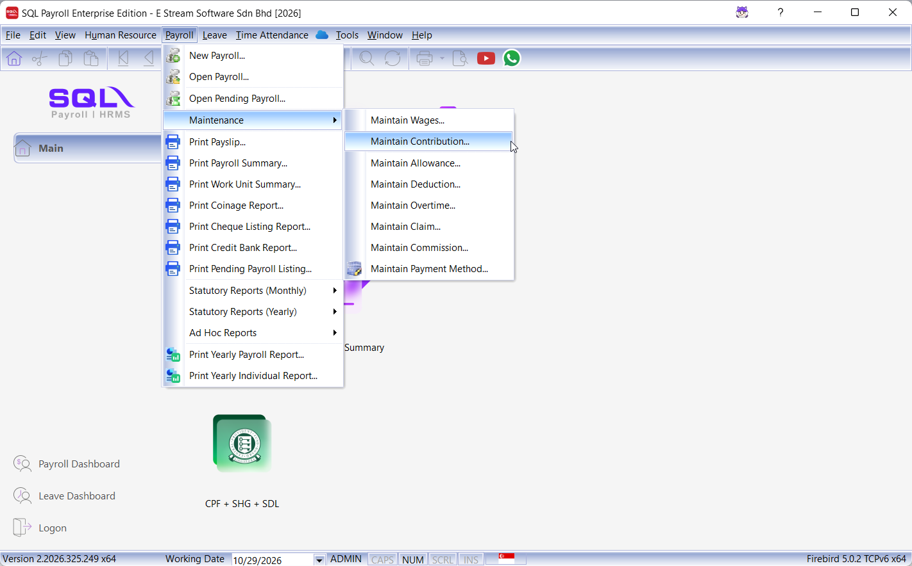 

2. Click **New** to create new contribution type.

    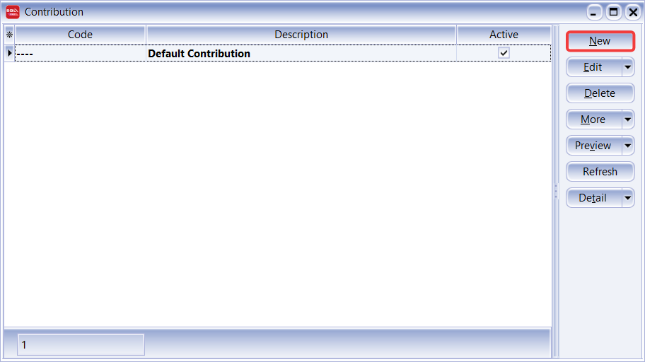  

#### 4.2.1 General

This tab is used for setting the Employee/Employer CPF rate and OT calculation.

:::info
System calculate Hourly OT Rate of Employee by:  
Daily Basis = Daily Basic Wage ÷ Working Hour Per Day  
Monthly Basis = 12 × Monthly Basic Wage ÷ 52 × Working Hour Per Week  
Monthly Basis on Rest Day = 12 × Monthly Basic Wage ÷ 52 × Working Day Per Week 
:::

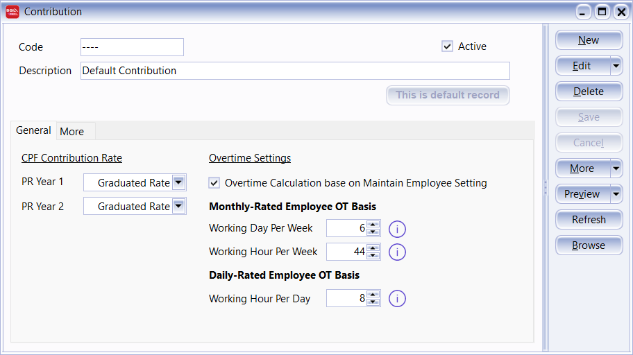

| Field Name                                             | Definition                                                                                                                                  |
| -------------------------------------------------------| --------------------------------------------------------------------------------------------------------------------------------------------|
| Code                                                   | A Contribution Code (Max 20 Characters)                                                                                                     |
| Description                                            | A Full Description for Contribution (Max 160 Characters)                                                                                    |
| Active                                                 | Uncheck if the selected Contribution code is unavailable                                                                                    |
| Set as Default                                         | Click this button to automatically assign this Contribution Code when creating a new employee at [Maintain Employee](#31-maintain-employee) |
| PR Year 1                                              | The CPF Contribution Rate applicable to Employee and Employer during Employee First Year of Permanent Resident status, associated with the CPF Table (eg. Full Rate, Graduated Rate) |
| PR Year 2                                              | The CPF Contribution Rate applicable to Employee and Employer during Employee Second Year of Permanent Resident status, associated with the CPF Table (eg. Full Rate, Graduated Rate)|
| Overtime Calculation base on Maintain Employee Setting | Check this to auto calculate the OT amount. If uncheck, OT amount will need to manually input after process month end.                      |
| Working Day Per Week                                   | Number of working days in a week                                                                                                            |
| Working Hour Per Week                                  | Number of working hours in a week                                                                                                           |
| Working Hour Per Day                                   | Number of working hours in a day                                                                                                            |

#### 4.2.2 More

This tab is used to check the contribution required.

| Field Name        | Definition                                                                                                                              |
| ------------------| ----------------------------------------------------------------------------------------------------------------------------------------|
| CPF               | Contribute to Ordinary Wages of Central Provident Fund (CPF)                                                                            |
| CPF (A)           | Contribute to Additional Wages of Central Provident Fund (CPF)                                                                          |
| SHG               | Contribute to Self Help Group of employee selected in Employee [Self-Help Group](#316-self-help-group) tab                              |
| SDL               | Contribute to Skill Development Levy of employee                                                                                        |
| IR8A              | Report to IR8A Form                                                                                                                     |
| OT                | Allow the amount to contribute to Overtime (OT)                                                                                         |

#### 4.2.3 Common Contribution Setup

| Citizen and Permanent Resident Workers                 | Foreign Workers                                        |
|--------------------------------------------------------|--------------------------------------------------------|
| 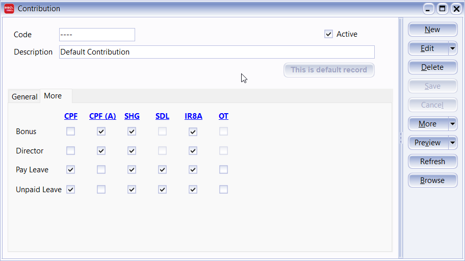 | 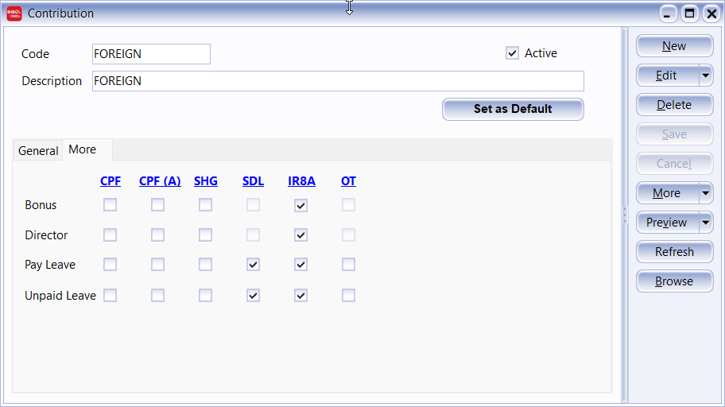 |

### 4.3 Maintain Allowance

- Setting up Maintain Allowance helps you categorize the type of allowance that employees are entitled to.
- This affects the types of contributions required and statutory reporting.
- This is especially useful if you have different types of allowances such as Petrol, Handphone, or Meal Allowance based on different company entitlements.

### 4.4 Maintain Deduction

### 4.5 Maintain Overtime

### 4.6 Maintain Claim

### 4.7 Maintain Commission

### 4.8 Maintain Payment Method
